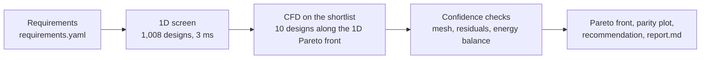

# Cold-plate design loop

An engineer's design loop for a liquid cold plate, automated end to end: a 1D physics model screens a thousand designs,
a CFD model checks the ten that matter, and the output is a Pareto front, a recommendation and the evidence for trusting it.


One command, about three seconds on a laptop, no LLM in the loop:

```bash
uv sync
uv run python run_study.py examples/gpu_coldplate.yaml
```

## The problem

A 1 kW chip on a 60 × 60 mm copper cold plate, cooled by 25% propylene glycol at 40 °C. Which fin geometry and flow rate
give the lowest thermal resistance for the least pressure drop, and how far can a hand-calculation-level model be trusted to answer that?

## How it works



1. **Screen.** A 1D resistance network (Shah & London laminar duct correlations, fin efficiency, coolant heating) evaluates every
   combination of channel width, fin thickness, fin height and flow rate, and discards designs that break the pressure or manufacturing limits.
2. **Verify.** Ten designs spread along the 1D Pareto front are solved with a 2D conjugate finite-element model of the channel cross-section
   (gmsh + scikit-fem): fluid velocity, and temperature in the fluid, fin and base together.
3. **Decide.** Mesh independence, solver residual and energy balance are checked and reported; the knee of the CFD-verified front is recommended.

## What it found

| | Channel / fin / height | Flow | R_th | ΔP |
|---|---|---|---|---|
| Recommended (knee) | 0.44 / 0.47 / 4.0 mm | 1.5 LPM | 15.7 mK/W | 1.2 kPa |
| Lowest resistance in budget | 0.15 / 0.15 / 1.5 mm | 1.5 LPM | 9.3 mK/W | 26.4 kPa |

The 1D screen and the CFD agree on thermal resistance to 0.9% on average and 2.9% at worst.
For straight fins in laminar flow, a correct 1D model is enough; the CFD is the evidence for that statement, not a replacement for it.


Full output: [`examples/output/gpu_coldplate/report.md`](examples/output/gpu_coldplate/report.md).

## Why trust the solver

`uv run python validation/duct_fully_developed.py` solves laminar flow and heat transfer in rectangular ducts at four aspect ratios
and reproduces the Shah & London reference values for f·Re and Nu to within 0.007%.

## What it does not do

The CFD is a 2D cross-section with fully developed flow. It does not capture entrance effects, manifolds, flow maldistribution,
or any geometry that varies along the flow. Every assumption is listed with its basis in [`ASSUMPTIONS.md`](ASSUMPTIONS.md).

## Layout

- `run_study.py` — the deterministic orchestrator.
- `tools/` — one function per engineering step: `screen_1d`, `mesh`, `run_cfd`, `postprocess`, `check_confidence`, `pareto`, `report`.
- `examples/` — the requirements file and a committed copy of its output.
- `validation/` — solver validation against analytical results.
- `prototypes/` — exploratory work toward the next fidelity level (2D Navier-Stokes).
- `SPEC.md`, `PLAN.md`, `DECISIONS.md`, `ASSUMPTIONS.md`, `PROGRESS.md` — scope, milestones, decisions, assumptions and current state.

MIT licence.
