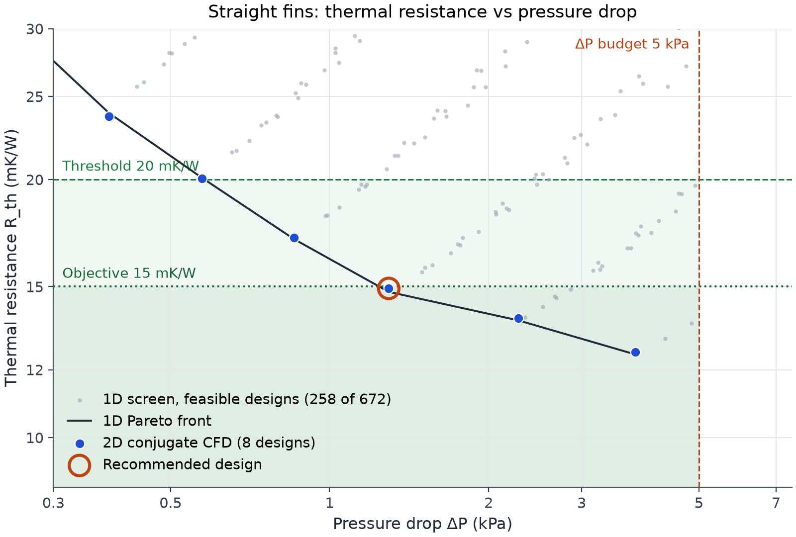
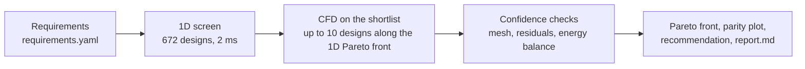
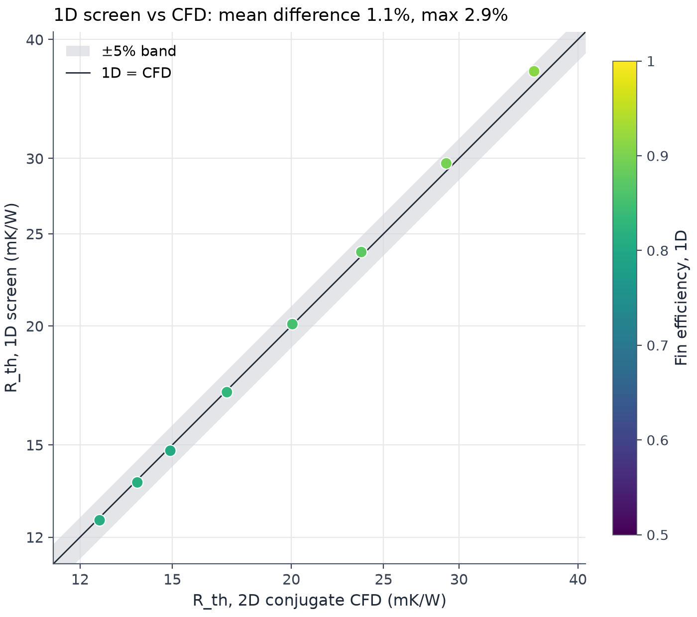
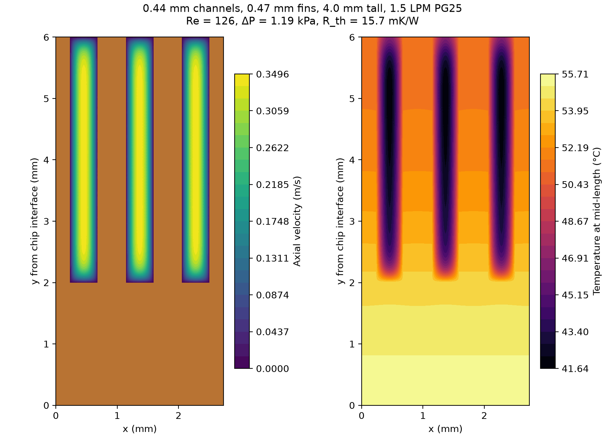
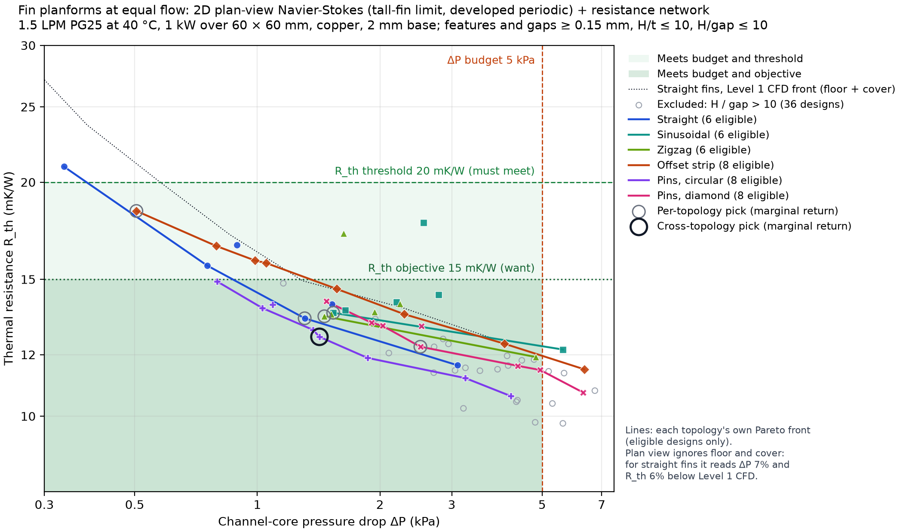
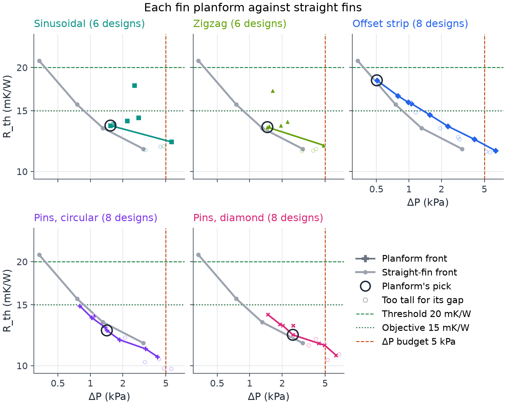

# Thermal design loop

A design loop for a liquid cold plate, run the way a thermal engineer would: a 1D physics model screens 672 fin geometries,
a conjugate CFD model checks the 8 along the Pareto front, and the output is a recommendation with the evidence for trusting it.

**[Read the case study: Choosing a cold plate for a 1 kW chip](https://riccardovietri.github.io/thermal-design-loop/)**



| | |
|---|---|
| **Operating point** | 1 kW over 60 × 60 mm, 25% propylene glycol at 40 °C inlet, 1.5 LPM |
| **Requirement** | Channel pressure drop ≤ 5 kPa; thermal resistance ≤ 20 mK/W (must), ≤ 15 mK/W (objective) |
| **Recommended design** | Straight copper fins: 0.42 mm channels, 0.44 mm fins, 4.0 mm tall. 14.9 mK/W at 1.29 kPa |
| **1D screen vs CFD** | Thermal resistance agrees within 1.1% on average, 2.9% at worst |
| **Main limitation** | Fully developed 2D flow: no entrance effects, manifolds or flow maldistribution, and no comparison with a measurement yet |

*Grey dots: the 1D screen; blue: designs checked with CFD; ring: the recommendation. Shading marks the 5 kPa budget with the
20 mK/W threshold (light) and the 15 mK/W objective (darker).*

One command, about three seconds on a laptop, no LLM in the loop:

```bash
uv sync
uv run python run_study.py examples/gpu_coldplate.yaml
```

## The problem

A 1 kW chip on a 60 × 60 mm copper cold plate, cooled by 25% propylene glycol at 40 °C. At a rated flow of 1.5 LPM, with a channel-core
pressure budget of 5 kPa, a thermal-resistance threshold of 20 mK/W that must be met and an objective of 15 mK/W, which fin geometry
is worth its pressure drop, and how far can a hand-calculation-level model be trusted to answer that?

## How it works



1. **Screen.** A 1D resistance network (Shah & London laminar duct correlations, fin efficiency, coolant heating) evaluates every
   combination of channel width, fin thickness and fin height at rated flow, and discards designs that break the pressure or manufacturing limits.
2. **Verify.** Up to ten designs spread along the 1D Pareto front are solved with a 2D conjugate finite-element model of the channel cross-section
   (gmsh + scikit-fem): fluid velocity, and temperature in the fluid, fin and base together.
3. **Decide.** Mesh independence, solver residual and energy balance are checked and reported. Among CFD-verified designs within the
   pressure budget that meet the threshold, the rule starts at the lowest pressure drop and moves along the front while a further design
   returns at least 0.25 in log-log terms (a doubling of pressure drop must buy at least about 16% lower resistance); it recommends the point
   where that stops and says whether it meets the objective. If nothing meets the threshold, the lowest resistance within budget is
   recommended and flagged.

## What it found

| | Channel / fin / height | R_th | ΔP |
|---|---|---|---|
| Recommended (marginal return, meets the 15 mK/W objective) | 0.42 / 0.44 / 4.0 mm | 14.9 mK/W | 1.29 kPa |
| Lowest ΔP meeting the 20 mK/W threshold | 0.50 / 0.44 / 4.0 mm | 17.1 mK/W | 0.86 kPa |
| Lowest resistance within 5 kPa | 0.30 / 0.26 / 2.5 mm | 12.6 mK/W | 3.79 kPa |

From the 0.50 mm design, moving to 0.42 mm channels returns 0.33 (14% lower resistance for 1.5× the pressure drop); going further
returns 0.14–0.16, below the 0.25 cut-off, so the rule stops there. The report lists every step, and for each design the heat load it
could carry at a 20 K rise (1.34 kW for the recommended one) and the heat moved per watt of pumping power.

All at the 1.5 LPM rated flow. The recommended design averages 54.9 °C at the chip interface; at 1.0 LPM it rises to 17.4 mK/W
(57.4 °C), at 2.0 LPM it falls to 13.7 mK/W (53.7 °C).
The 1D screen and the CFD agree on thermal resistance to 1.1% on average and 2.9% at worst.
For straight fins in laminar flow, a correct 1D model is enough; the CFD is the evidence for that statement, not a replacement for it.





*The recommended design's cross-section at 1.5 LPM: coolant velocity (copper in brown) and temperature at mid-length.*

Full output: [`examples/output/gpu_coldplate/report.md`](examples/output/gpu_coldplate/report.md).

Level 2 (`level2/`, 2D planar Navier-Stokes) tests confined slot-jet arrays on a flat base at the same flow, with jet gaps and slots
of at least 0.1 mm: the best reaches 23.8 mK/W at 0.49 kPa, so none meets the 20 mK/W threshold
([comparison](examples/output/level2_slot_jet/pareto_compare.png): 18 slot-jet arrays coloured by jet gap, marker by slot width,
against the straight-fin CFD designs, all at 1.5 LPM PG25, 1 kW over 60 × 60 mm).

## More topologies

Level 2 also has a plan-view model (`level2/planview.py`): 2D Navier-Stokes and energy in the plane of the fin layer for
sinusoidal and zigzag channels, offset strip fins and staggered circular and diamond pins, solved as developed-periodic cells and put
into the same resistance network as Level 1, at the same 1.5 LPM, footprint and 0.15 mm manufacturing limits, with fin height at most
10 times the narrowest gap.



*Each line is one planform's Pareto front over its eligible designs (1.5 LPM PG25 at 40 °C, 1 kW over 60 × 60 mm, copper,
2 mm base). The ring is the design the rule picks across all planforms. The 36 designs whose fins are taller than 10 × their
narrowest gap are left out. The plan view has no floor or cover: on straight fins it reads ΔP 7% and R_th 6% below the
cross-section CFD.*



*One panel per planform: its designs and front in colour against the straight-fin front in grey, with the planform's own pick ringed.*

The honest headline: staggered circular pins are the best planform in this model, but only by 3–6% at equal pressure drop,
which is inside the 6% this model reads low on straight fins because it has no floor or cover. The same marginal-return rule picks
pins of 0.4 mm diameter at 0.8 × 0.9 mm pitch (12.7 mK/W at 1.42 kPa) across all topologies, and 0.4 mm straight fins and channels
(13.4 mK/W at 1.31 kPa) among straight fins. Nobody has shown a volume process for 0.15 mm pin or wavy features in copper, so a
non-straight pick carries manufacturing risk this model does not assess. Wavy fins and offset strips do not beat straight fins here: in 2D a wavy channel at these
Reynolds numbers adds pressure drop without new flow structure (the Dean vortices that help real wavy fins are 3D), and the 0.15 mm
gap between strip rows halves the fin density. Straight fins remain a sound choice; pins are worth a 3D check.
Picks, rule steps and excluded designs: [`summary.md`](examples/output/level2_planview/summary.md); field plots and all numbers:
[`examples/output/level2_planview/`](examples/output/level2_planview/).

## Why trust the solver

`uv run python validation/duct_fully_developed.py` solves laminar flow and heat transfer in rectangular ducts at four aspect ratios
and reproduces the Shah & London reference values for f·Re and Nu to within 0.007%.

## What it does not do

The CFD is a 2D cross-section with fully developed flow. It does not capture entrance effects, manifolds, flow maldistribution,
or any geometry that varies along the flow. Every assumption is listed with its basis in [`ASSUMPTIONS.md`](ASSUMPTIONS.md).

## Layout

- `run_study.py` — the deterministic orchestrator.
- `tools/` — one function per engineering step: `screen_1d`, `mesh`, `run_cfd`, `postprocess`, `check_confidence`, `pareto`, `report`.
- `examples/` — the requirements file and a committed copy of its output.
- `validation/` — solver validation against analytical results.
- `prototypes/` — exploratory work toward the next fidelity level (2D Navier-Stokes).
- `SPEC.md`, `PLAN.md`, `DECISIONS.md`, `ASSUMPTIONS.md`, `PROGRESS.md` — scope, milestones, decisions, assumptions and current state.

MIT licence.
