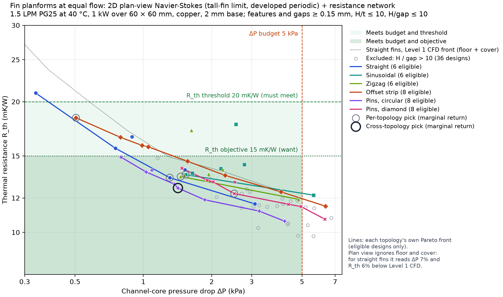
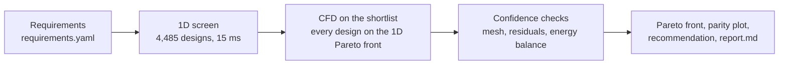
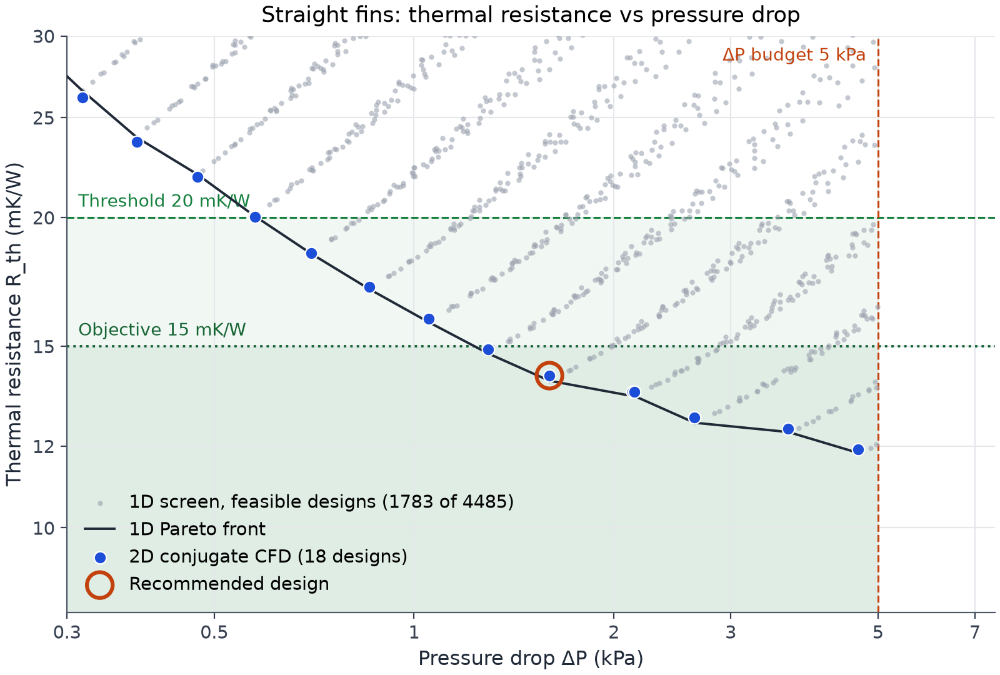
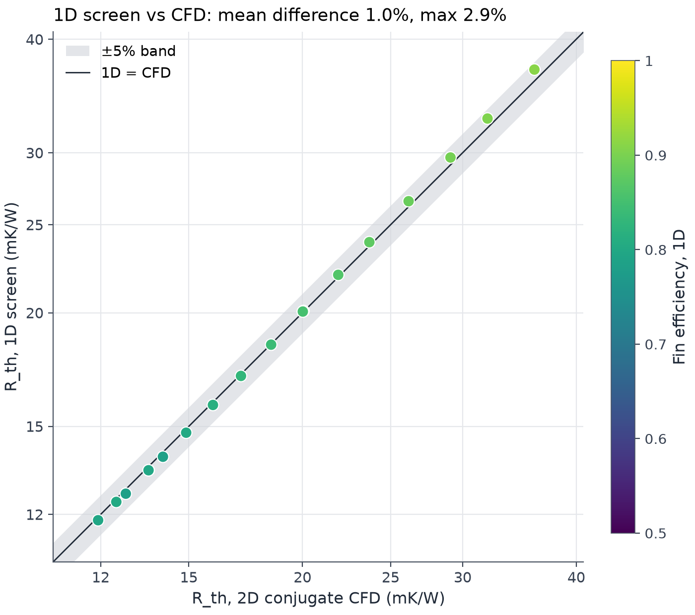
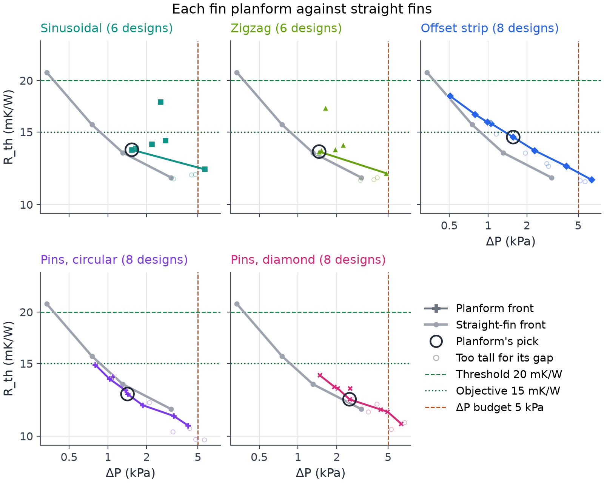
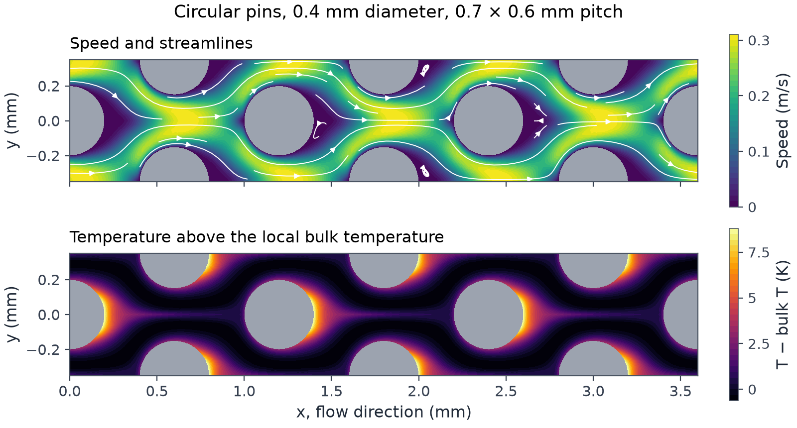

# Thermal design loop

A design loop for a liquid cold plate, run the way a thermal engineer would: a 1D physics model screens 4,485 fin geometries,
a conjugate CFD model checks all 18 on the Pareto front, and the output is a recommendation with the evidence for trusting it.

**[Read the case study: Choosing a cold plate for a 1 kW chip](https://riccardovietri.github.io/thermal-design-loop/)**



*Thermal resistance against pressure drop for six fin shapes (78 plan-view designs solved, 1.5 LPM); the ring is the design picked across all shapes.*

| | |
|---|---|
| **Operating point** | 1 kW over 60 × 60 mm, 25% propylene glycol at 40 °C inlet, 1.5 LPM |
| **Requirement** | Channel pressure drop ≤ 5 kPa; thermal resistance ≤ 20 mK/W (must), ≤ 15 mK/W (objective) |
| **Recommended design** | Straight copper fins: 0.39 mm channels, 0.39 mm fins, 3.75 mm tall. 14.0 mK/W at 1.60 kPa |
| **1D screen vs CFD** | Thermal resistance agrees within 1.0% on average, 2.9% at worst (18 designs) |
| **Main limitation** | The default study is fully developed 2D flow; entrance effects are quantified separately (13.7 mK/W at 1.62 kPa, objective margin 8.9%, [summary](examples/output/entrance_effects/summary.md)). No manifolds or flow maldistribution, and no comparison with a measurement yet |

One command, about five seconds on a laptop, no LLM in the loop:

```bash
uv sync
uv run python run_study.py examples/gpu_coldplate.yaml
```

On Linux, gmsh also needs a few system libraries (the ones CI installs):
`sudo apt-get install -y libglu1-mesa libxcursor1 libxinerama1 libxft2`.

## The problem

A 1 kW chip on a 60 × 60 mm copper cold plate, cooled by 25% propylene glycol at 40 °C. At a rated flow of 1.5 LPM, with a channel-core
pressure budget of 5 kPa, a thermal-resistance threshold of 20 mK/W that must be met and an objective of 15 mK/W, which fin geometry
is worth its pressure drop, and how far can a hand-calculation-level model be trusted to answer that?

## How it works



1. **Screen.** A 1D resistance network (Shah & London laminar duct correlations, fin efficiency, coolant heating) evaluates every
   combination of channel width, fin thickness and fin height at rated flow, and discards designs that break the pressure or manufacturing limits.
2. **Verify.** Every design on the 1D Pareto front within the budget (18 here) is solved with a 2D conjugate finite-element model of the channel cross-section
   (gmsh + scikit-fem): fluid velocity, and temperature in the fluid, fin and base together.
3. **Decide.** Mesh independence, solver residual and energy balance are checked and reported (the last two are conservation
   and consistency checks, not evidence of thermal accuracy). Among CFD-verified designs within the
   pressure budget that meet the threshold, the rule starts at the lowest pressure drop and moves along the front while a further design
   returns at least 0.25 in log-log terms (a doubling of pressure drop must buy at least about 16% lower resistance), ignoring designs
   less than 10% further in pressure drop; it recommends the point where that stops. If that point misses the objective and a further
   design meets it, the rule continues to the lowest pressure drop that does, and says so. If nothing meets the threshold, the lowest
   resistance within budget is recommended and flagged.

## What it found



*Straight fins. Grey dots: the 1D screen; blue: designs checked with CFD; ring: the recommendation. Shading marks the 5 kPa budget
with the 20 mK/W threshold (light) and the 15 mK/W objective (darker).*

| | Channel / fin / height | R_th | ΔP |
|---|---|---|---|
| Recommended (marginal return, meets the 15 mK/W objective) | 0.39 / 0.39 / 3.75 mm | 14.0 mK/W | 1.60 kPa |
| Lowest ΔP meeting the 15 mK/W objective | 0.42 / 0.39 / 3.75 mm | 14.9 mK/W | 1.29 kPa |
| Lowest ΔP meeting the 20 mK/W threshold | 0.55 / 0.44 / 4.0 mm | 18.5 mK/W | 0.70 kPa |
| Lowest resistance within 5 kPa | 0.27 / 0.26 / 2.5 mm | 11.9 mK/W | 4.66 kPa |

The rule walks the front from 0.55 mm channels in four steps, with returns of 0.38, 0.35, 0.33 and finally 0.28 from 0.42 mm to 0.39 mm
channels (6% lower resistance for 1.24× the pressure drop); every further design returns 0.19 or less, so it stops there. The report
lists every step, and for each design the heat load it could carry at a 20 K rise (1.42 kW for the recommended one) and the heat moved
per watt of pumping power.

The cut-off of 0.25 is a judgment, so the report re-runs the rule from 0.05 to 0.60: the pick holds from 0.20 to 0.25; from 0.30 up it
is the 0.42 mm design at 1.29 kPa, below 0.20 it moves to higher pressure drop. Returns between neighbouring designs fall gradually
(about 0.7 at 0.2 kPa, 0.28–0.41 from 0.7 to 1.6 kPa, mostly below 0.2 beyond), so there is no sharp knee for the cut-off to find.
An earlier, coarser grid stopped at 1.29 kPa because it had no design between 1.29 and 2.28 kPa; the denser grid adds one whose
return clears the cut-off.

All at the 1.5 LPM rated flow. The recommended design averages 54.0 °C at the chip interface; at 1.0 LPM it rises to 16.5 mK/W
(56.5 °C), at 2.0 LPM it falls to 12.8 mK/W (52.8 °C).
The 1D screen and the CFD agree on thermal resistance to 1.0% on average and 2.9% at worst.
For the straight-fin designs studied here (laminar, fully developed, uniform heat flux, 2D cross-section), the 1D model gives the
same answer as the CFD; the CFD is the evidence for that statement, not a replacement for it. Agreement between two models is not
agreement with hardware: no measured plate has been compared yet ([issue #11](https://github.com/riccardovietri/thermal-design-loop/issues/11)).



The velocity and temperature fields of the recommended design's cross-section are in the
[report](examples/output/gpu_coldplate/report.md#confidence-checks), with the mesh study.

Full output: [`examples/output/gpu_coldplate/report.md`](examples/output/gpu_coldplate/report.md).

Level 2 (`level2/`, 2D planar Navier-Stokes) tests confined slot-jet arrays on a flat base at the same flow, with jet gaps and slots
of at least 0.1 mm: the best reaches 23.8 mK/W at 0.49 kPa, so none meets the 20 mK/W threshold
([comparison](examples/output/level2_slot_jet/pareto_compare.png): 18 slot-jet arrays coloured by jet gap, marker by slot width,
against the straight-fin CFD designs, all at 1.5 LPM PG25, 1 kW over 60 × 60 mm).

## More topologies

Level 2 also has a plan-view model (`level2/planview.py`): 2D Navier-Stokes and energy in the plane of the fin layer for
sinusoidal and zigzag channels, offset strip fins and staggered circular and diamond pins, solved as developed-periodic cells and put
into the same resistance network as Level 1, at the same 1.5 LPM, footprint and 0.15 mm manufacturing limits, with fin height at most
10 times the narrowest gap.

The first figure on this page shows each planform's Pareto front over its eligible designs (1.5 LPM PG25 at 40 °C, 1 kW over
60 × 60 mm, copper, 2 mm base). The ring is the design the rule picks across all planforms. The 36 designs whose fins are taller
than 10 × their narrowest gap are left out. The plan view has no floor or cover: on straight fins it reads ΔP 7% and R_th 6% below
the cross-section CFD.



*One panel per planform: its designs and front in colour against the straight-fin front in grey, with the planform's own pick ringed.*



*Staggered circular pins in plan view (0.4 mm diameter, 0.7 × 0.6 mm pitch, 1.5 LPM): speed with streamlines (top) and temperature above the local bulk (bottom).*

The honest headline: staggered circular pins are the best planform in this model, but only by 3–6% at equal pressure drop,
which is inside the 6% this model reads low on straight fins because it has no floor or cover. The same marginal-return rule picks
pins of 0.4 mm diameter at 0.8 × 0.9 mm pitch (12.6 mK/W at 1.42 kPa) across all topologies, and 0.4 mm straight fins and channels
(13.4 mK/W at 1.31 kPa) among straight fins. For offset strips the walk stops at its first point (18.4 mK/W), and the objective
clause continues to the lowest-pressure design that meets 15 mK/W (14.6 mK/W at 1.57 kPa). Across planforms the pick names a
different pin array at 0.20 and at 0.30, but it is circular pins at every cut-off from 0.05 to 0.60. Nobody has shown a volume process for 0.15 mm pin or wavy features in copper, so a
non-straight pick carries manufacturing risk this model does not assess. Wavy fins and offset strips do not beat straight fins here: in 2D a wavy channel at these
Reynolds numbers adds pressure drop without new flow structure (the Dean vortices that help real wavy fins are 3D), and the 0.15 mm
gap between strip rows halves the fin density. Straight fins remain a sound choice; pins are worth a 3D check.
Picks, rule steps and excluded designs: [`summary.md`](examples/output/level2_planview/summary.md); field plots and all numbers:
[`examples/output/level2_planview/`](examples/output/level2_planview/).

## Why trust the solver

`uv run python validation/duct_fully_developed.py` solves laminar flow and heat transfer in rectangular ducts at four aspect ratios
and reproduces the Shah & London reference values for f·Re and Nu to within 0.007%. This verifies the toolchain (gmsh, scikit-fem,
the element choice) on a separate fluid-only problem. It does not call the production conjugate solver (`tools/run_cfd.py`), whose
own tests are looser (0.2% on f·Re, 5% on a limiting Nusselt number); a conjugate benchmark through `run_cfd()` is open as
[issue #24](https://github.com/riccardovietri/thermal-design-loop/issues/24).

The residual and energy-balance rows of the report's confidence checks are conservation and consistency checks. They pass close to
machine precision partly by construction, so they show each solve is self-consistent, not that the thermal model is accurate.

## What it does not do

The default study (1D screen and CFD) is a 2D cross-section with fully developed flow. Entrance effects are quantified separately
in [`examples/output/entrance_effects/summary.md`](examples/output/entrance_effects/summary.md): for the recommended design developing
flow lowers R_th from 14.05 to 13.66 mK/W and raises the channel-core ΔP from 1.600 to 1.617 kPa, so the objective margin grows
from 6.3% to 8.9%. That correction is checked only between parallel plates (tall-fin limit), not in the real duct. The study does
not capture manifolds, flow maldistribution, or any geometry that varies along the flow, and it has not been compared with a measured
plate. Every assumption is listed with its basis in [`ASSUMPTIONS.md`](ASSUMPTIONS.md).

## Layout

- `run_study.py` — the deterministic orchestrator.
- `tools/` — one function per engineering step: `screen_1d`, `mesh`, `run_cfd`, `postprocess`, `check_confidence`, `pareto`, `report`.
- `level2/` — 2D Navier-Stokes models: slot jets, plan-view fin planforms and the entrance-effect check.
- `examples/` — the requirements file and a committed copy of each study's output.
- `validation/` — toolchain and solver checks against analytical and independent solutions, with their saved results.
- `docs/` — the case study (`index.html`, published with GitHub Pages), build log, literature survey and work plan.
- `prototypes/` — exploratory code (a wavy-channel Level 2 prototype); not covered by tests and not part of the pipeline.
- `SPEC.md`, `PLAN.md`, `DECISIONS.md`, `ASSUMPTIONS.md`, `PROGRESS.md` — scope, milestones, decisions, assumptions and current state.

MIT licence.
