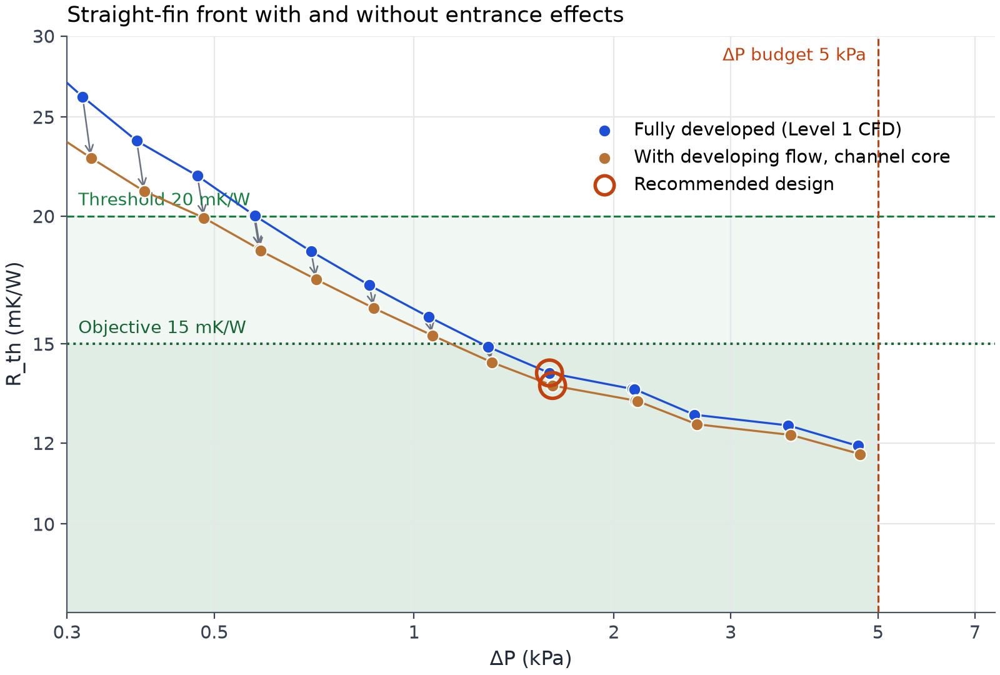

# Entrance effects in the straight-fin study (issue #12)

**Answer.** For the recommended design (0.39 mm channels, 0.39 mm fins, 3.75 mm tall, 77 channels, Re 114, x* = L/(Dh·Re·Pr) = 0.065), developing flow lowers R_th from 14.05 to 13.66 mK/W (-2.8%) and raises the channel-core ΔP from 1.600 to 1.617 kPa (+1.1%). **The 15 mK/W objective is met with a margin of 8.9%** (6.3% fully developed). Values are the Level 1 CFD result plus the 1D increment. With the resolved tall-fin ratios in place of the 1D ones the design reads 13.75 mK/W at 1.618 kPa; plenum to plenum the resolved solve adds a further 0.19·ρU²/2 (5 Pa) for the inlet and outlet.

**Gate.** In the tall-fin (parallel-plate) limit the re-anchored 1D correction and the resolved solve agree on the entrance contribution to within +3.1% on R_th and -2.9% on ΔP for the recommended design (limit ±10%): **pass**. All five resolved designs are in the table below. The first version of this check (earlier Level 1 pick, 0.42 / 0.44 / 4.0 mm) failed at −36% on R_th and +41% on ΔP; the earlier formulation, applied to the current pick, still gives -36% and +41%. Across the five designs the re-anchored correction differs from the resolved contribution by -10.8%, +1.9%, +3.1%, +3.6%, +5.6% on R_th and -0.9%, -2.7%, -2.9%, -2.8%, -2.8% on ΔP (widest to narrowest); the widest channel is the only one outside ±10% on R_th, where x* is smallest and the entrance dominates. What changed, approved by Riccardo before the rerun and not fitted to the resolved solves:
- *Thermal:* the published entrance asymptotes are now blended with the screen's own developed Nusselt number (Shah & London Nu_H1) instead of the source's developed-limit formula, which at small aspect ratio reads 19% above the exact parallel-plate value and so hid part of the entrance gain. The long-channel limit is now exactly the fully developed model.
- *Hydrodynamic:* fully developed friction plus an incremental pressure drop K(∞)·ρU²/2 with K(∞) = 0.680 (parallel plates, from a published table; see Sources), in place of the apparent-friction blend, whose long-channel tail was worth about 0.99·ρU²/2.
- *Inlet and outlet:* the Kays coefficients are reported as a separate term and no longer added to any combined figure (reason below). For the recommended design they would add 20 Pa.

**Front and recommendation.** The order of the 18 CFD-verified designs by R_th is unchanged; wide channels gain most (x* is smallest there). 0.65 / 0.44 / 4.00 mm, 0.60 / 0.44 / 4.00 mm, 0.60 / 0.39 / 3.75 mm now meet the 20 mK/W threshold (19.92, 18.56, 18.50 mK/W). The selection rule on the corrected values walks 0.65 / 0.44 / 4.00 → 0.60 / 0.44 / 4.00 → 0.55 / 0.44 / 4.00 → 0.50 / 0.44 / 4.00 → 0.46 / 0.44 / 4.00 → 0.42 / 0.39 / 3.75 mm and picks 0.42 / 0.39 / 3.75 mm (fully developed: 0.55 / 0.44 / 4.00 → 0.50 / 0.44 / 4.00 → 0.46 / 0.44 / 4.00 → 0.42 / 0.39 / 3.75 → 0.39 / 0.39 / 3.75 mm). **The pick would move** to 0.42 / 0.39 / 3.75 mm (14.39 mK/W at 1.309 kPa with entrance effects, 14.90 mK/W at 1.293 kPa fully developed). The step from it to the current pick returns 0.248 with entrance effects against 0.277 fully developed, just under the 0.25 cut-off: the corrections lower R_th by slightly more on the wider design. This is the same one-step move the cut-off sensitivity in the Level 1 report shows near 0.25; the study keeps fully developed values by default, so it is reported here and not applied.

Geometry is channel width / fin thickness / fin height in mm.

## Sources and formulas
See `docs/literature.md` and `ASSUMPTIONS.md` rows P2 and P9–P12.
- **Thermal and simultaneous entrance, uniform wall flux:** Muzychka & Yovanovich (2002), Part II, Eqs. 50–52 with their Table 2 (C3 = 0.501, f(Pr) = 0.886/[1 + (1.909 Pr^(1/6))^(9/2)]^(2/9), m = 2.27 + 1.65 Pr^(1/3)), local form (C2 = C4 = 1), z* = z/(√A·Re_√A·Pr): Nu_G = [(C3 (f·Re_√A / z*)^(1/3))⁵ + Nu_fd⁵]^(1/5), Nu = [Nu_G^m + (f(Pr)/√z*)^m]^(1/m), with Nu_fd the screen's Shah & London Nu_H1 converted to √A (re-anchored). Valid for 0.1 < Pr < ∞; stated accuracy ±12% (Graetz) and ±15% (combined entry). R_th uses the mean of (wall − bulk) temperature over the length, so the effective h is the harmonic length-mean of the local h.
- **Hydrodynamic entrance:** ΔP = ΔP_fd + K(∞)·ρU²/2, U the channel mean velocity, K(∞) = 0.680: Ray, Durst & Ray (2017), arXiv:1707.04947, Table 2, parallel-plate channel, Kn = 10⁻⁴ (continuum), first-order slip (C2 = 0): K1 = 0.6802, the high-Re asymptote of their Navier–Stokes K_fd from a uniform inlet. Their full correlation adds K0/Re (K0 = 80.3 on Dh = 2 × gap), which comes from axial diffusion upstream of a uniform profile imposed at the inlet plane; in a plate fed from a plenum that profile is not imposed, and the resolved solve (with a slip lead-in ahead of the fin) gives a Re-independent value close to K1. The same K(∞) is used for the real duct (aspect ratio about 0.1); no open tabulation for rectangular ducts was obtained.
- **Inlet and outlet losses (reported separately):** laminar abrupt-contraction and abrupt-expansion coefficients of Kays (1950) for flat and square ducts, as polynomial fits in σ interpolated linearly in aspect ratio by dos Reis & Altemani (COBEM 1999, Eq. 5, Table 1); ΔP_io = (Kc + Ke)·ρU²/2, σ = w/(w + t), plenum as tall as the fins.

## R_th and ΔP per design

| Design | x* | R_th fully developed | thermal entrance only | combined entry | ΔP fully developed | ΔP with developing flow (core) | inlet/outlet, separate |
|---|---|---|---|---|---|---|---|
| 1.00 / 0.44 / 4.00 | 0.018 | 35.98 | 28.46 | 28.37 | 182 | 190 | 5 |
| 0.92 / 0.44 / 4.00 | 0.021 | 31.95 | 26.28 | 26.22 | 216 | 224 | 6 |
| 0.84 / 0.44 / 4.00 | 0.023 | 29.09 | 24.67 | 24.62 | 264 | 273 | 7 |
| 0.77 / 0.44 / 4.00 | 0.026 | 26.17 | 22.83 | 22.80 | 317 | 326 | 8 |
| 0.71 / 0.44 / 4.00 | 0.029 | 23.69 | 21.18 | 21.15 | 382 | 392 | 8 |
| 0.65 / 0.44 / 4.00 | 0.032 | 21.90 | 19.94 | 19.92 | 472 | 483 | 10 |
| 0.60 / 0.44 / 4.00 | 0.036 | 20.05 | 18.57 | 18.56 | 573 | 585 | 11 |
| 0.60 / 0.39 / 3.75 | 0.037 | 20.02 | 18.52 | 18.50 | 576 | 587 | 10 |
| 0.55 / 0.44 / 4.00 | 0.041 | 18.47 | 17.35 | 17.34 | 700 | 712 | 13 |
| 0.50 / 0.44 / 4.00 | 0.046 | 17.12 | 16.27 | 16.26 | 856 | 870 | 14 |
| 0.46 / 0.44 / 4.00 | 0.051 | 15.94 | 15.29 | 15.29 | 1051 | 1066 | 16 |
| 0.42 / 0.39 / 3.75 | 0.059 | 14.90 | 14.40 | 14.39 | 1293 | 1309 | 17 |
| 0.39 / 0.39 / 3.75 **(recommended)** | 0.065 | 14.05 | 13.66 | 13.66 | 1600 | 1617 | 20 |
| 0.36 / 0.39 / 3.50 | 0.069 | 13.55 | 13.21 | 13.20 | 2134 | 2156 | 26 |
| 0.36 / 0.34 / 3.25 | 0.070 | 13.55 | 13.19 | 13.19 | 2150 | 2171 | 24 |
| 0.33 / 0.34 / 3.25 | 0.078 | 12.79 | 12.52 | 12.52 | 2644 | 2668 | 28 |
| 0.30 / 0.30 / 2.75 | 0.082 | 12.48 | 12.22 | 12.22 | 3664 | 3696 | 36 |
| 0.27 / 0.26 / 2.50 | 0.091 | 11.92 | 11.71 | 11.70 | 4664 | 4700 | 40 |

R_th in mK/W, ΔP in Pa. Thermal entrance only: Graetz model (developed velocity). Combined entry: velocity and temperature developing together from a uniform inlet; this is the corrected R_th. The inlet/outlet column is (Kc + Ke)·ρU²/2 and is not included in any other column. Coefficients and factors:

| Design | Re | σ | Kc | Ke | h factor, thermal | h factor, combined | ρU²/2 (Pa) | ΔP factor | L/(Dh·Re) |
|---|---|---|---|---|---|---|---|---|---|
| 1.00 / 0.44 / 4.00 | 177 | 0.693 | 0.709 | -0.252 | 1.362 | 1.368 | 11.7 | 1.0440 | 0.212 |
| 0.92 / 0.44 / 4.00 | 168 | 0.674 | 0.712 | -0.225 | 1.307 | 1.312 | 12.1 | 1.0382 | 0.240 |
| 0.84 / 0.44 / 4.00 | 163 | 0.655 | 0.715 | -0.198 | 1.266 | 1.269 | 13.2 | 1.0340 | 0.265 |
| 0.77 / 0.44 / 4.00 | 155 | 0.635 | 0.719 | -0.170 | 1.226 | 1.229 | 13.8 | 1.0296 | 0.299 |
| 0.71 / 0.44 / 4.00 | 148 | 0.615 | 0.723 | -0.141 | 1.192 | 1.194 | 14.6 | 1.0259 | 0.337 |
| 0.65 / 0.44 / 4.00 | 144 | 0.594 | 0.727 | -0.112 | 1.167 | 1.169 | 16.0 | 1.0231 | 0.372 |
| 0.60 / 0.44 / 4.00 | 138 | 0.573 | 0.732 | -0.082 | 1.142 | 1.144 | 17.1 | 1.0203 | 0.418 |
| 0.60 / 0.39 / 3.75 | 137 | 0.606 | 0.720 | -0.126 | 1.145 | 1.147 | 17.0 | 1.0201 | 0.427 |
| 0.55 / 0.44 / 4.00 | 133 | 0.552 | 0.737 | -0.051 | 1.122 | 1.123 | 18.3 | 1.0178 | 0.469 |
| 0.50 / 0.44 / 4.00 | 128 | 0.531 | 0.742 | -0.019 | 1.105 | 1.106 | 19.8 | 1.0157 | 0.527 |
| 0.46 / 0.44 / 4.00 | 123 | 0.509 | 0.747 | 0.014 | 1.090 | 1.091 | 21.4 | 1.0138 | 0.590 |
| 0.42 / 0.39 / 3.75 | 117 | 0.522 | 0.741 | -0.003 | 1.079 | 1.080 | 23.0 | 1.0121 | 0.673 |
| 0.39 / 0.39 / 3.75 | 114 | 0.500 | 0.746 | 0.029 | 1.068 | 1.069 | 25.3 | 1.0107 | 0.751 |
| 0.36 / 0.39 / 3.50 | 118 | 0.478 | 0.754 | 0.061 | 1.065 | 1.065 | 31.9 | 1.0102 | 0.791 |
| 0.36 / 0.34 / 3.25 | 117 | 0.512 | 0.744 | 0.011 | 1.066 | 1.067 | 32.0 | 1.0101 | 0.801 |
| 0.33 / 0.34 / 3.25 | 113 | 0.491 | 0.749 | 0.043 | 1.057 | 1.057 | 34.7 | 1.0089 | 0.899 |
| 0.30 / 0.30 / 2.75 | 119 | 0.503 | 0.747 | 0.024 | 1.057 | 1.057 | 46.7 | 1.0087 | 0.936 |
| 0.27 / 0.26 / 2.50 | 117 | 0.515 | 0.742 | 0.006 | 1.051 | 1.052 | 53.5 | 1.0078 | 1.040 |

*R_th against channel-core ΔP for the 18 CFD-verified straight-fin designs of the Level 1 study at 1.5 LPM PG25: fully developed (Level 1 CFD, blue) and with developing flow (copper, arrows join each design); corrections are the re-anchored 1D increments added to the CFD values; inlet and outlet losses are not included. Budget 5 kPa (channel core), threshold 20 mK/W, objective 15 mK/W. Circled: the Level 1 recommended design (0.39 / 0.39 / 3.75 mm). Region of interest as in the Level 1 report (from 0.3 kPa): 1.00 / 0.44 / 4.00, 0.92 / 0.44 / 4.00, 0.84 / 0.44 / 4.00 mm (below 0.3 kPa) are off the plot and in the tables.*

## Resolved check (tall-fin limit)

Three solves per design with the plan-view solver (`level2/planar.py`, the solver behind `level2.planview.run_developing`), uniform flux on the fin walls, inlet temperature uniform:
1. **Combined entry:** one straight half channel over the full 60 mm, uniform velocity 1 mm upstream of the fin leading edge with slip walls there (a uniform profile imposed right at the wall corner makes the inlet pressure singular, and the pressure drop then grows with mesh refinement; the slip lead-in removes that).
2. **Thermal entrance only:** the same channel with a parabolic inlet profile at x = 0.
3. **Plenum to plenum (ΔP only):** a 2 mm inlet plenum, half a fin of thickness t with square ends over 60 mm, a 10 mm outlet plenum; plenums as tall as the fins (σ = w/(w + t)).

Length-mean h = q''/(mean wall T − mean bulk T over 0–60 mm); ΔP from the inlet line to x = 60 mm. Developed reference: the streamwise-periodic cell. The 1D columns evaluate the re-anchored correction for the same channel (parallel plates of gap w, aspect ratio 0.01, developed Nu 8.235 on 2w); the earlier columns are the first formulation.

**Tall-fin limit.** The plan view has fins of infinite height: no floor, no cover, both channel walls heated. So it checks development between two fins, not the real duct with an aspect ratio of about 0.1 and an adiabatic cover (ASSUMPTIONS V1). Corner regions of the real duct develop differently and are not checked here.

| Design | Re (2w) | x* (2w) | h increase: resolved / 1D / earlier 1D | ΔP increase: resolved / 1D / earlier 1D | ΔR_th resolved / 1D (mK/W) | 1D vs resolved, R_th contribution | 1D vs resolved, ΔP contribution | energy balance |
|---|---|---|---|---|---|---|---|---|
| 1.00 / 0.44 / 4.00 | 218 | 0.012 | +25.2% / +21.9% / +13.7% | +5.19% / +5.15% / +7.26% | -4.553 / -4.060 | -10.8% | -0.9% | +0.037% |
| 0.42 / 0.39 / 3.75 | 130 | 0.047 | +5.9% / +6.0% / +3.7% | +1.34% / +1.30% / +1.88% | -0.342 / -0.349 | +1.9% | -2.7% | +0.012% |
| 0.39 / 0.39 / 3.75 **(recommended)** | 125 | 0.054 | +5.1% / +5.3% / +3.2% | +1.18% / +1.14% / +1.65% | -0.266 / -0.274 | +3.1% | -2.9% | +0.011% |
| 0.36 / 0.39 / 3.50 | 128 | 0.057 | +4.8% / +5.0% / +3.0% | +1.11% / +1.08% / +1.56% | -0.235 / -0.244 | +3.6% | -2.8% | +0.011% |
| 0.27 / 0.26 / 2.50 | 129 | 0.074 | +3.7% / +3.9% / +2.4% | +0.86% / +0.83% / +1.21% | -0.141 / -0.149 | +5.6% | -2.8% | +0.008% |

ΔR_th: change of the plan-view network R_th from the developed value. Thermal entrance only (parabolic inlet):

| Design | h increase, resolved | h increase, 1D (Graetz) | ΔR_th resolved (mK/W) | ΔR_th 1D (mK/W) | energy balance |
|---|---|---|---|---|---|
| 1.00 / 0.44 / 4.00 | +25.0% | +21.5% | -4.526 | -3.998 | -0.050% |
| 0.42 / 0.39 / 3.75 | +5.9% | +5.9% | -0.341 | -0.344 | -0.013% |
| 0.39 / 0.39 / 3.75 | +5.1% | +5.2% | -0.264 | -0.270 | -0.012% |
| 0.36 / 0.39 / 3.50 | +4.8% | +4.9% | -0.235 | -0.241 | -0.011% |
| 0.27 / 0.26 / 2.50 | +3.7% | +3.9% | -0.140 | -0.147 | -0.009% |

Plenum to plenum, in units of the channel dynamic pressure ρU²/2:

| Design | σ | ρU²/2 (Pa) | total excess over developed, resolved | of which developing channel (K, resolved) | of which inlet + outlet, resolved | K(∞) used in 1D | Kc + Ke (Kays, flat duct) |
|---|---|---|---|---|---|---|---|
| 1.00 / 0.44 / 4.00 | 0.693 | 11.4 | 0.59 | 0.69 | -0.10 | 0.68 | 0.43 |
| 0.42 / 0.39 / 3.75 | 0.522 | 22.9 | 0.86 | 0.70 | +0.16 | 0.68 | 0.72 |
| 0.39 / 0.39 / 3.75 | 0.500 | 25.0 | 0.89 | 0.70 | +0.19 | 0.68 | 0.76 |
| 0.36 / 0.39 / 3.50 | 0.478 | 31.3 | 0.92 | 0.70 | +0.22 | 0.68 | 0.80 |
| 0.27 / 0.26 / 2.50 | 0.515 | 52.8 | 0.87 | 0.70 | +0.17 | 0.68 | 0.73 |

Mesh check, recommended design, 8 → 16 cells across the half channel: combined entry h +0.007%, ΔP -0.0009% (entrance increments 5.12% → 5.13% on h and 1.176% → 1.175% on ΔP); thermal entrance h -0.0001%; plenum ΔP +0.0053%.

**Gates.** mesh change at 2x refinement, recommended design: 0.01% (limit 2%), pass; energy balance, all resolved solves: 0.050% (limit 1%), pass; 1D vs resolved, entrance contribution to R_th (recommended): +3.1% (limit ±10%), pass; 1D vs resolved, entrance contribution to ΔP (recommended): -2.9% (limit ±10%), pass.

## Why inlet and outlet losses are kept separate
Plenum to plenum, the resolved inlet-plus-outlet loss is -0.10 to +0.22·ρU²/2 over the five designs, against Kays Kc + Ke of 0.43 to 0.80. The gap is nearly constant (0.53 to 0.57) and close to the resolved entrance excess of the channel itself (0.69 to 0.70). That pattern fits laminar contraction coefficients that already contain part of the entrance pressure defect, so adding them to K(∞) would count it twice. Kays's paper was not obtained, so this could not be confirmed from the source. The term is also outside the channel-core ΔP definition of the study. It is therefore listed on its own and added to nothing.

## Not covered
- Flow maldistribution between channels, manifold, port and fitting losses (ASSUMPTIONS P5, P6).
- Axial conduction in the copper base, which moves heat toward the inlet where h is higher. With it the effective h lies between the harmonic length-mean used here and the arithmetic mean, so the R_th reductions here are the smaller estimate.
- Temperature-dependent viscosity (P3), and the 3D development of the real duct (floor, cover, corners); the K(∞) for the real duct is the parallel-plate value.

Reproduce: `uv run python -m level2.entrance` (about 5 minutes); `--plot-only` redraws the figure and this file from `results.json`.
