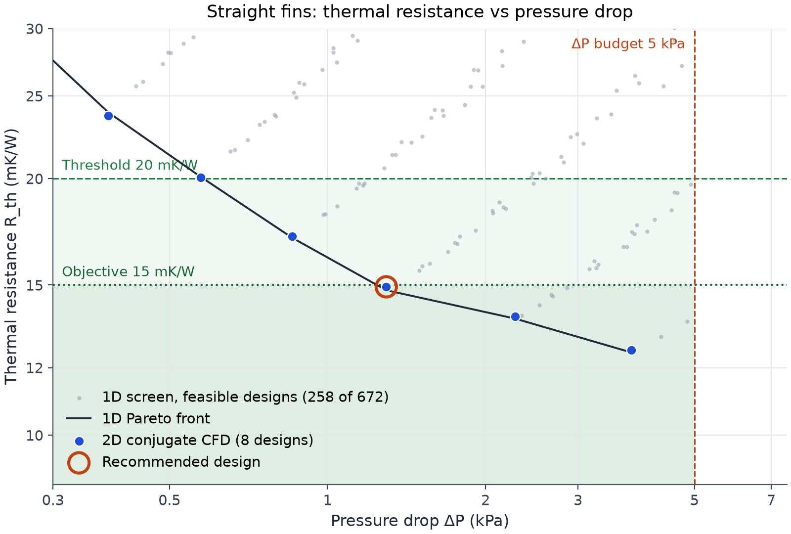
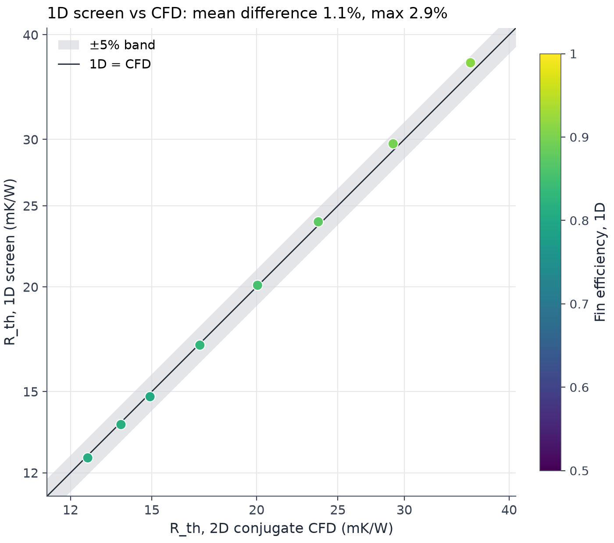
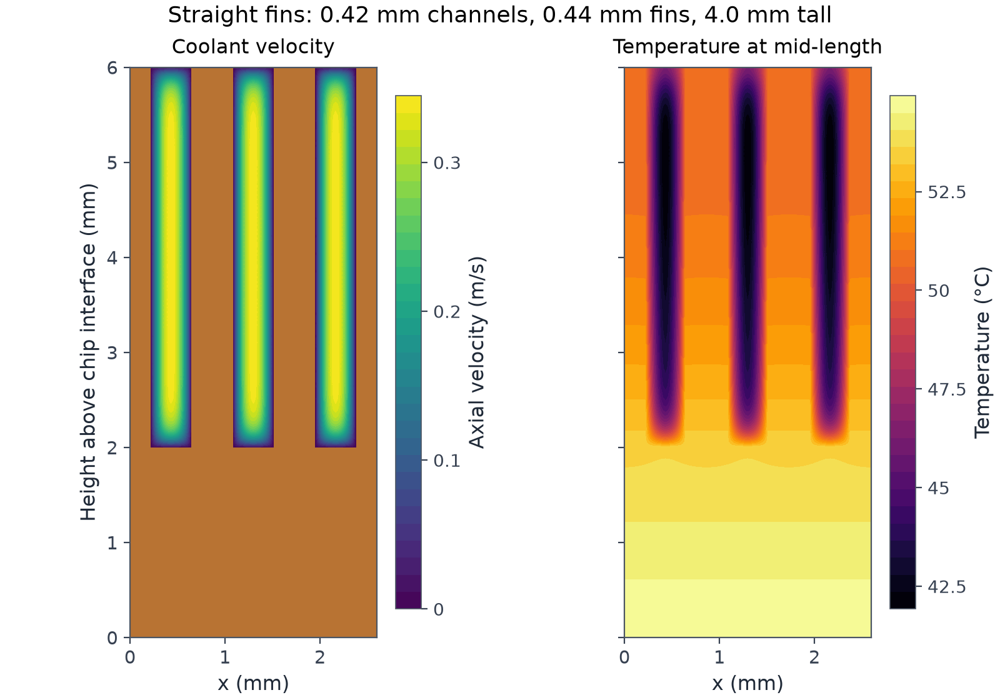

# Cold-plate design study: gpu_coldplate

**Recommended design:** 0.42 mm channels, 0.44 mm fins, 4.0 mm tall (69 channels) at 1.5 LPM (rated flow). CFD gives R_th = 14.9 mK/W at ΔP = 1.29 kPa, so the chip interface averages 54.9 °C (peak 59.9 °C) for 1000 W and 40 °C inlet. It meets the 20 mK/W threshold and meets the 15 mK/W objective.

## Why this design
- Requirements: channel-core ΔP ≤ 5 kPa at rated flow (budget); R_th ≤ 20 mK/W (threshold, must meet); R_th ≤ 15 mK/W (objective, want).
- Rule (marginal return, cut-off 0.25): Candidates are the CFD-verified designs with ΔP ≤ budget and R_th ≤ threshold; take their non-dominated front sorted by ΔP. Start at the lowest-ΔP front point. From the current point i, compute the return e(i→j) = −ln(R_j / R_i) / ln(ΔP_j / ΔP_i) to every front point j further along. If any j has e ≥ the cut-off, move to the nearest such j and repeat; otherwise stop and recommend the current point. A cut-off of 0.25 means a doubling of ΔP must buy at least about 16% lower R_th. If no design meets the threshold within budget, the lowest R_th within budget is recommended and the threshold is reported as not met.
- Rule that fired: `marginal_return`: at least one CFD-verified design meets both the budget and the threshold, so the marginal-return walk along their front picks the design.

Steps the rule took (returns from the current point to every further point on the eligible front; **bold** = at or above the cut-off 0.25):

| Step | From (channel / fin / height) | R_th (mK/W) | ΔP (kPa) | Returns to further points | Moved to |
|---|---|---|---|---|---|
| 1 | 0.50 / 0.44 / 4.0 mm | 17.12 | 0.86 | **0.331** to 0.42 / 0.44 / 4.0 mm; 0.222 to 0.36 / 0.44 / 3.5 mm; 0.207 to 0.30 / 0.26 / 2.5 mm | 0.42 / 0.44 / 4.0 mm |
| 2 | 0.42 / 0.44 / 4.0 mm | 14.93 | 1.29 | 0.141 to 0.36 / 0.44 / 3.5 mm; 0.159 to 0.30 / 0.26 / 2.5 mm | stop: recommended |

Reference designs (CFD-verified, within budget):

| Reference | Channel / fin / height | R_th (mK/W) | ΔP (kPa) |
|---|---|---|---|
| Lowest ΔP meeting the threshold (20 mK/W) | 0.50 / 0.44 / 4.0 mm | 17.12 | 0.86 |
| Lowest ΔP meeting the objective (15 mK/W) (recommended) | 0.42 / 0.44 / 4.0 mm | 14.93 | 1.29 |
| Lowest R_th within budget | 0.30 / 0.26 / 2.5 mm | 12.58 | 3.79 |

- At the recommended point the resistance splits into base conduction 1.4, fin and convection 8.4, and coolant heating 5.0 mK/W (1D breakdown).

Thermal resistance against channel pressure drop at the rated 1.5 LPM. Grey dots: every feasible design from the 1D screen; dark line: its Pareto front; blue: the designs solved with 2D conjugate CFD; ring: the recommended design. The plot shows the region of interest only: ΔP from 0.3 kPa to 1.5× the budget, R_th from 0.7× the lowest feasible value to 1.5× the threshold. Designs outside it are screened but not drawn. Light shading: meets the budget and the threshold; darker: meets the budget and the objective.

## Flow sensitivity of the recommended design

| Flow (LPM) | ΔP (kPa) | R_th (mK/W) | Average interface (°C) | Peak interface (°C) |
|---|---|---|---|---|
| 1.0 | 0.86 | 17.43 | 57.4 | 64.9 |
| 1.5 (rated) | 1.29 | 14.93 | 54.9 | 59.9 |
| 2.0 | 1.73 | 13.68 | 53.7 | 57.4 |

## 1D screen vs CFD
The 1D screen evaluated 672 designs (258 feasible) in 3 ms. 8 designs spread along its Pareto front were solved with the 2D conjugate model in 1.1 s.

- R_th: 1D differs from CFD by 1.1% on average, 2.9% at worst (mean signed +0.4%).
- ΔP: identical to within 0.03%. This is expected, not a result: both models assume fully developed flow and share the same f·Re.

R_th from the 1D screen against the 2D conjugate CFD for each solved design, coloured by the 1D fin efficiency; the band is ±5%.

Ratios (CFD): Capacity = threshold × heat load / R_th, the heat load the design could carry at the threshold rise (base-to-inlet rise of threshold × heat load, 20 K here); capacity per kPa = capacity / ΔP; kW per pumping W = heat load / (ΔP × volumetric flow), using hydraulic power. Both ratios always favour the lowest ΔP inside the window, which is why they are reported and not used to choose.

| Channel (mm) | Fin (mm) | Height (mm) | Flow (LPM) | Re | ΔP CFD (kPa) | R_th 1D (mK/W) | R_th CFD (mK/W) | 1D − CFD | Fin eff. | Capacity (kW) | kW per kPa | kW per pumping W |
|---|---|---|---|---|---|---|---|---|---|---|---|---|
| 1.00 | 0.44 | 4.0 | 1.5 | 177 | 0.18 | 37.04 | 35.98 | +2.9% | 0.91 | 0.56 | 3.06 | 220.3 |
| 0.84 | 0.44 | 4.0 | 1.5 | 163 | 0.26 | 29.64 | 29.09 | +1.9% | 0.89 | 0.69 | 2.61 | 151.7 |
| 0.71 | 0.44 | 4.0 | 1.5 | 148 | 0.38 | 23.92 | 23.69 | +1.0% | 0.88 | 0.84 | 2.21 | 104.7 |
| 0.60 | 0.44 | 4.0 | 1.5 | 138 | 0.57 | 20.09 | 20.05 | +0.2% | 0.85 | 1.00 | 1.74 | 69.7 |
| 0.50 | 0.44 | 4.0 | 1.5 | 128 | 0.86 | 17.04 | 17.12 | -0.4% | 0.83 | 1.17 | 1.36 | 46.7 |
| 0.42 **(recommended)** | 0.44 | 4.0 | 1.5 | 119 | 1.29 | 14.79 | 14.93 | -0.9% | 0.80 | 1.34 | 1.04 | 30.9 |
| 0.36 | 0.44 | 3.5 | 1.5 | 125 | 2.28 | 13.70 | 13.78 | -0.6% | 0.81 | 1.45 | 0.64 | 17.6 |
| 0.30 | 0.26 | 2.5 | 1.5 | 121 | 3.79 | 12.50 | 12.58 | -0.6% | 0.81 | 1.59 | 0.42 | 10.5 |

## Confidence checks

| Check | Value | Limit | Result |
|---|---|---|---|
| Mesh independence, R_th (production vs 2× finer) | 0.001% | < 1.0% | pass |
| Mesh independence, ΔP (production vs 2× finer) | 0.000% | < 1.0% | pass |
| Linear solver residual, worst run | 4.8e-12 | < 1e-08 | pass |
| Energy balance: flux recovered at chip interface vs applied, worst run | 0.000% | < 1.0% | pass |
| Laminar assumption: highest Reynolds number | 177 | < 2000 | pass |
| Mesh quality: lowest element quality (SICN) | 0.76 | > 0.3 | pass |

Mesh study on `w0422_t0444_h4000_q150`:

| Cells across half channel | Unknowns | R_th (mK/W) | ΔP (kPa) |
|---|---|---|---|
| 4 | 4995 | 14.9276 | 1.2943 |
| 8 | 18559 | 14.9281 | 1.2942 |
| 16 | 71883 | 14.9283 | 1.2942 |

Recommended design at 1.5 LPM PG25: axial velocity (left; copper in brown) and temperature at mid-length (right) on the cross-section, mirrored to show three channels. Re = 119, ΔP = 1.29 kPa, R_th = 14.9 mK/W.

## Inputs
- Heat load 1000 W, uniform over 60 × 60 mm; 2.0 mm base, k = 390 W/m·K.
- Rated flow 1.5 LPM (1.5 LPM per kW); the Pareto study is run at rated flow only. ΔP budget 5 kPa (channel core, at rated flow; one third of a 15 kPa whole-plate allocation). R_th threshold 20 mK/W, objective 15 mK/W, marginal-return cut-off 0.25.
- PG25 at 40 °C (CoolProp): ρ = 1010.6 kg/m³, cp = 3958 J/kg·K, k = 0.481 W/m·K, μ = 1.394 mPa·s.
- R_th = (average chip-interface temperature − inlet temperature) / heat load. TIM and junction-to-case are excluded.

## Design basis
- Feature limits (≥ 0.15 mm, aspect ratio ≤ 10) sit inside published skived-copper practice: 0.1–0.8 mm fins with 0.1 mm minimum gap (Boyd fabrication guide); 100–200 µm fins and gaps, 1–2 mm tall, in direct-to-chip cold plates (ASME mini-channel study).
- Base thickness is a fixed assumption. Published designs span 0.1 mm (manifold microcoolers) to 4.5 mm (a commercial 55 mm plate); no typical value was found.

## What this model does not capture
- Entrance effects and inlet/outlet losses (both models are fully developed).
- Flow maldistribution between channels, manifolds and fittings.
- Temperature-dependent properties, non-uniform heat flux and heat spreading from a die smaller than the plate.
- Anything three-dimensional. Each CFD run is a 2D cross-section of one fin and channel.

Every CFD number traces to `runs/gpu_coldplate/<design_id>/` (inputs, mesh, results, fields).
