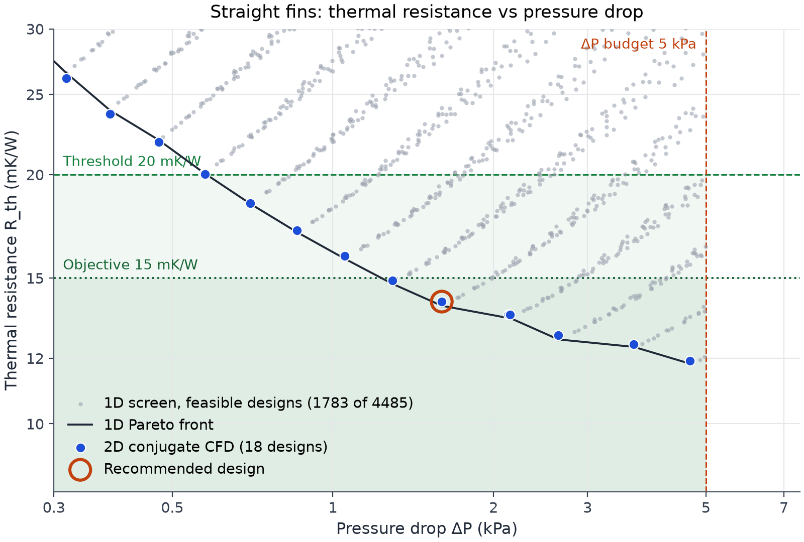
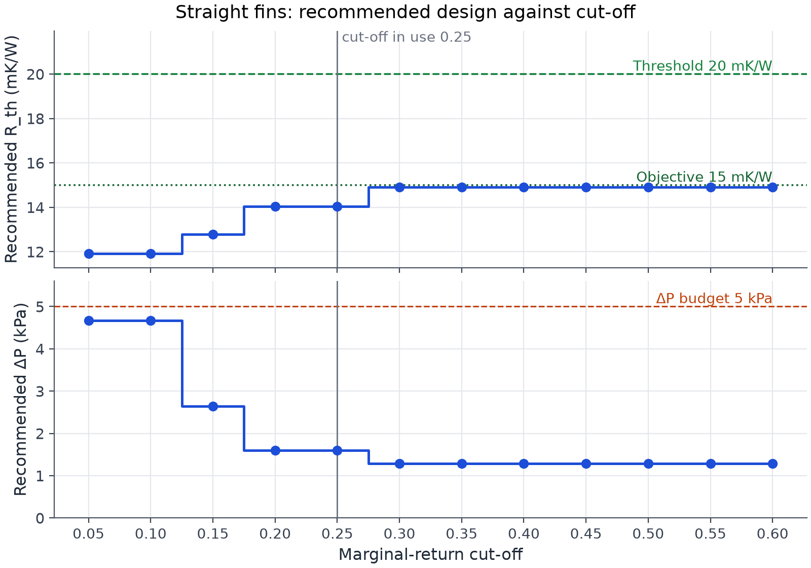
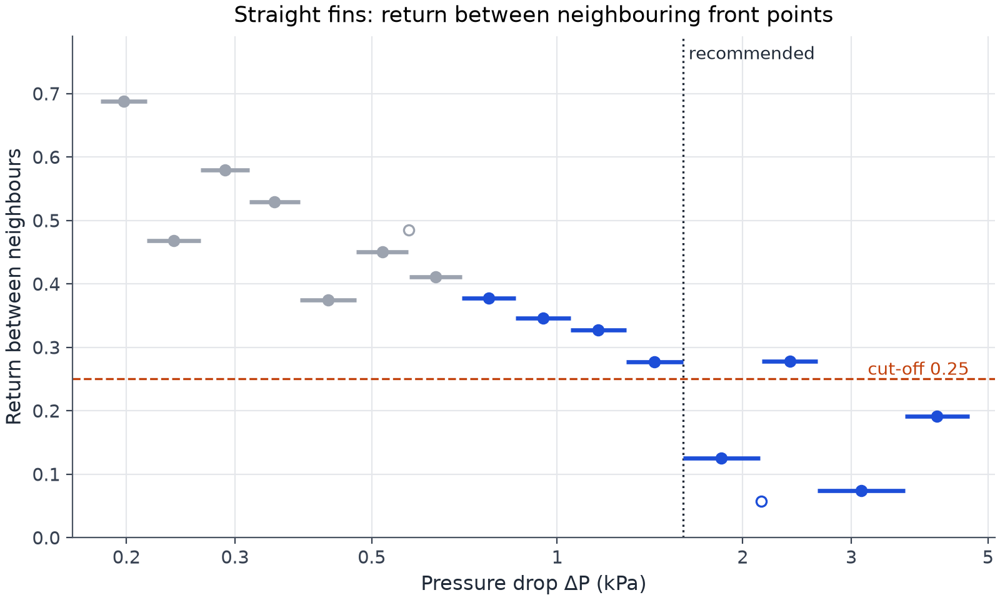
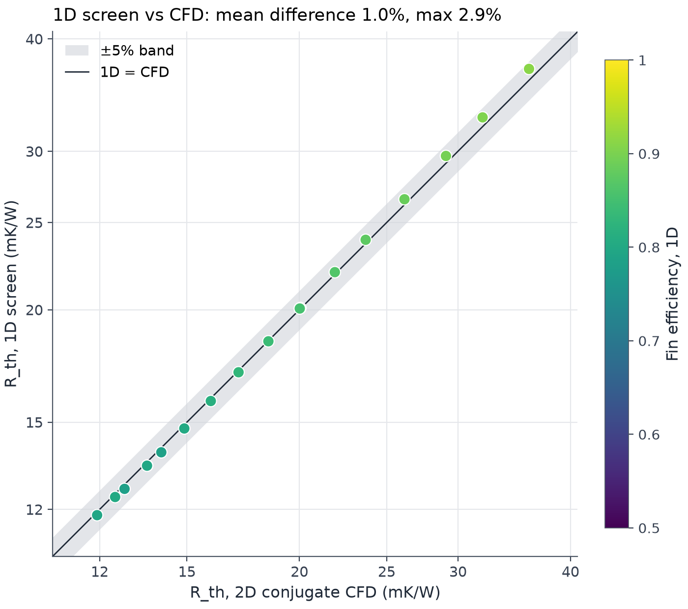
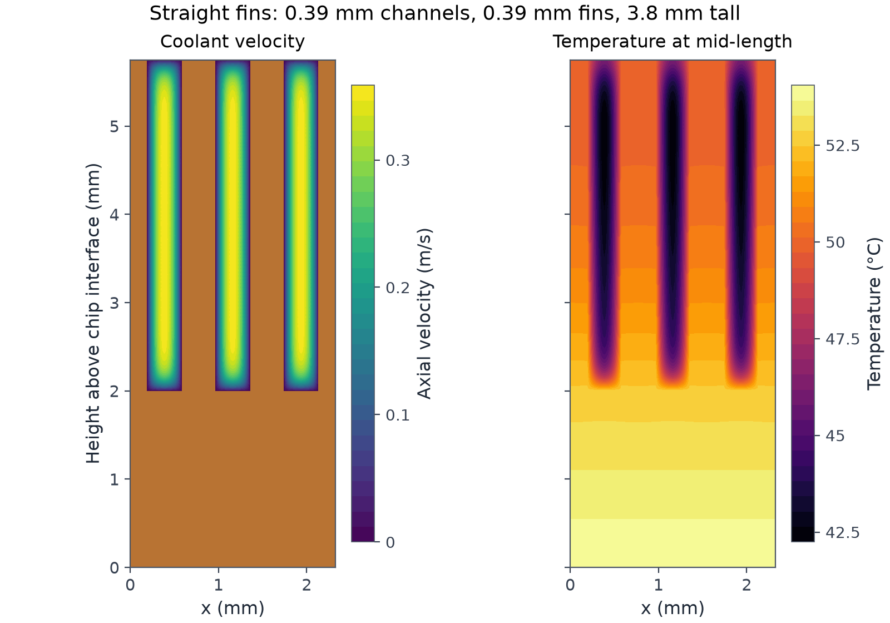

# Cold-plate design study: gpu_coldplate

**Recommended design:** 0.39 mm channels, 0.39 mm fins, 3.75 mm tall (77 channels) at 1.5 LPM (rated flow). CFD gives R_th = 14.0 mK/W at ΔP = 1.60 kPa, so the chip interface averages 54.0 °C (peak 59.0 °C) for 1000 W and 40 °C inlet. It meets the 20 mK/W threshold and meets the 15 mK/W objective.

## Why this design
- Requirements: channel-core ΔP ≤ 5 kPa at rated flow (budget); R_th ≤ 20 mK/W (threshold, must meet); R_th ≤ 15 mK/W (objective, want).
- Rule (marginal return, cut-off 0.25, minimum ΔP ratio 1.10): Candidates are the CFD-verified designs with ΔP ≤ budget and R_th ≤ threshold; take their non-dominated front sorted by ΔP. Start at the lowest-ΔP front point. From the current point i, compute the return e(i→j) = −ln(R_j / R_i) / ln(ΔP_j / ΔP_i) to every front point j further along. If any j has e ≥ the cut-off, move to the nearest such j and repeat; otherwise stop and recommend the current point. A cut-off of 0.25 means a doubling of ΔP must buy at least about 16% lower R_th. Guard (SPEC Amendment 4): a point j with ΔP_j / ΔP_i below the minimum ratio (1.10) is ignored when looking from i, so two nearly coincident designs cannot produce a large return. Objective clause (SPEC Amendment 4): if the walk stops at a design that misses the objective and a design further along the eligible front meets it, the rule continues to the lowest-ΔP design that meets it. If no design meets the threshold within budget, the lowest R_th within budget is recommended and the threshold is reported as not met.
- Rule that fired: `marginal_return`: at least one CFD-verified design meets both the budget and the threshold, so the marginal-return walk along their front picks the design.

Steps the rule took (returns from the current point to every further point on the eligible front; **bold** = at or above the cut-off 0.25; *skipped* = ΔP ratio below the guard's 1.10):

| Step | From (channel / fin / height) | R_th (mK/W) | ΔP (kPa) | Returns to further points | Moved to |
|---|---|---|---|---|---|
| 1 | 0.55 / 0.44 / 4.00 mm | 18.47 | 0.70 | **0.378** to 0.50 / 0.44 / 4.00 mm; **0.362** to 0.46 / 0.44 / 4.00 mm; **0.350** to 0.42 / 0.39 / 3.75 mm; **0.331** to 0.39 / 0.39 / 3.75 mm; **0.278** to 0.36 / 0.39 / 3.50 mm; **0.276** to 0.36 / 0.34 / 3.25 mm; **0.277** to 0.33 / 0.34 / 3.25 mm; 0.237 to 0.30 / 0.30 / 2.75 mm; 0.231 to 0.27 / 0.26 / 2.50 mm | 0.50 / 0.44 / 4.00 mm |
| 2 | 0.50 / 0.44 / 4.00 mm | 17.12 | 0.86 | **0.346** to 0.46 / 0.44 / 4.00 mm; **0.337** to 0.42 / 0.39 / 3.75 mm; **0.316** to 0.39 / 0.39 / 3.75 mm; **0.256** to 0.36 / 0.39 / 3.50 mm; **0.254** to 0.36 / 0.34 / 3.25 mm; **0.259** to 0.33 / 0.34 / 3.25 mm; 0.217 to 0.30 / 0.30 / 2.75 mm; 0.213 to 0.27 / 0.26 / 2.50 mm | 0.46 / 0.44 / 4.00 mm |
| 3 | 0.46 / 0.44 / 4.00 mm | 15.94 | 1.05 | **0.327** to 0.42 / 0.39 / 3.75 mm; **0.302** to 0.39 / 0.39 / 3.75 mm; 0.230 to 0.36 / 0.39 / 3.50 mm; 0.228 to 0.36 / 0.34 / 3.25 mm; 0.239 to 0.33 / 0.34 / 3.25 mm; 0.196 to 0.30 / 0.30 / 2.75 mm; 0.195 to 0.27 / 0.26 / 2.50 mm | 0.42 / 0.39 / 3.75 mm |
| 4 | 0.42 / 0.39 / 3.75 mm | 14.90 | 1.29 | **0.277** to 0.39 / 0.39 / 3.75 mm; 0.189 to 0.36 / 0.39 / 3.50 mm; 0.188 to 0.36 / 0.34 / 3.25 mm; 0.214 to 0.33 / 0.34 / 3.25 mm; 0.170 to 0.30 / 0.30 / 2.75 mm; 0.174 to 0.27 / 0.26 / 2.50 mm | 0.39 / 0.39 / 3.75 mm |
| 5 | 0.39 / 0.39 / 3.75 mm | 14.05 | 1.60 | 0.125 to 0.36 / 0.39 / 3.50 mm; 0.123 to 0.36 / 0.34 / 3.25 mm; 0.187 to 0.33 / 0.34 / 3.25 mm; 0.142 to 0.30 / 0.30 / 2.75 mm; 0.153 to 0.27 / 0.26 / 2.50 mm | stop: recommended |

Objective clause: not needed; the walk stopped at a design that meets the objective.

Reference designs (CFD-verified, within budget):

| Reference | Channel / fin / height | R_th (mK/W) | ΔP (kPa) |
|---|---|---|---|
| Lowest ΔP meeting the threshold (20 mK/W) | 0.55 / 0.44 / 4.00 mm | 18.47 | 0.70 |
| Lowest ΔP meeting the objective (15 mK/W) | 0.42 / 0.39 / 3.75 mm | 14.90 | 1.29 |
| Lowest R_th within budget | 0.27 / 0.26 / 2.50 mm | 11.92 | 4.66 |

- At the recommended point the resistance splits into base conduction 1.4, fin and convection 7.5, and coolant heating 5.0 mK/W (1D breakdown).

Thermal resistance against channel pressure drop at the rated 1.5 LPM. Grey dots: every feasible design from the 1D screen; dark line: its Pareto front; blue: the designs solved with 2D conjugate CFD; ring: the recommended design. The plot shows the region of interest only: ΔP from 0.3 kPa to 1.5× the budget, R_th from 0.7× the lowest feasible value to 1.5× the threshold. Designs outside it are screened but not drawn. Light shading: meets the budget and the threshold; darker: meets the budget and the objective.

## Sensitivity to the cut-off

The rule re-run on the same CFD-verified designs for cut-offs from 0.05 to 0.60 (guard and objective clause on throughout). No new solves.

| Cut-off | Recommended (channel / fin / height) | R_th (mK/W) | ΔP (kPa) | Rule | Walk stopped at |
|---|---|---|---|---|---|
| 0.05 | 0.27 / 0.26 / 2.50 mm | 11.92 | 4.66 | `marginal_return` | same |
| 0.10 | 0.27 / 0.26 / 2.50 mm | 11.92 | 4.66 | `marginal_return` | same |
| 0.15 | 0.33 / 0.34 / 3.25 mm | 12.79 | 2.64 | `marginal_return` | same |
| 0.20 | 0.39 / 0.39 / 3.75 mm | 14.05 | 1.60 | `marginal_return` | same |
| 0.25 (in use) | 0.39 / 0.39 / 3.75 mm | 14.05 | 1.60 | `marginal_return` | same |
| 0.30 | 0.42 / 0.39 / 3.75 mm | 14.90 | 1.29 | `marginal_return` | same |
| 0.35 | 0.42 / 0.39 / 3.75 mm | 14.90 | 1.29 | `marginal_return_then_objective` | 0.50 / 0.44 / 4.00 mm |
| 0.40 | 0.42 / 0.39 / 3.75 mm | 14.90 | 1.29 | `marginal_return_then_objective` | 0.55 / 0.44 / 4.00 mm |
| 0.45 | 0.42 / 0.39 / 3.75 mm | 14.90 | 1.29 | `marginal_return_then_objective` | 0.55 / 0.44 / 4.00 mm |
| 0.50 | 0.42 / 0.39 / 3.75 mm | 14.90 | 1.29 | `marginal_return_then_objective` | 0.55 / 0.44 / 4.00 mm |
| 0.55 | 0.42 / 0.39 / 3.75 mm | 14.90 | 1.29 | `marginal_return_then_objective` | 0.55 / 0.44 / 4.00 mm |
| 0.60 | 0.42 / 0.39 / 3.75 mm | 14.90 | 1.29 | `marginal_return_then_objective` | 0.55 / 0.44 / 4.00 mm |

Recommended R_th (top) and ΔP (bottom) against the marginal-return cut-off; the vertical line is the cut-off in use. The current recommendation is unchanged for cut-offs from 0.20 to 0.25.

## Local return along the front

Return e between neighbouring points of the CFD-verified front within budget (18 points), drawn as a segment from the lower to the higher ΔP of each pair. Blue: pairs whose lower-ΔP point meets the threshold; grey: it does not. Hollow markers and dashed segments: neighbours closer than the guard's ΔP ratio of 1.10, which the rule ignores. The dashed line is the cut-off in use; the dotted line marks the recommended design. The rule compares the current point with every further point, not only its neighbour, so a single segment below the cut-off does not by itself stop the walk.

## Flow sensitivity of the recommended design

| Flow (LPM) | ΔP (kPa) | R_th (mK/W) | Average interface (°C) | Peak interface (°C) |
|---|---|---|---|---|
| 1.0 | 1.07 | 16.55 | 56.5 | 64.0 |
| 1.5 (rated) | 1.60 | 14.05 | 54.0 | 59.0 |
| 2.0 | 2.13 | 12.80 | 52.8 | 56.5 |

## 1D screen vs CFD
The 1D screen evaluated 4485 designs (1783 feasible) in 13 ms. Every design on its Pareto front within budget (18) was solved with the 2D conjugate model in 2.8 s.

- R_th: 1D differs from CFD by 1.0% on average, 2.9% at worst (mean signed +0.1%).
- ΔP: identical to within 0.03%. This is expected, not a result: the screen evaluates a polynomial fit of f·Re and the CFD derives friction from its solved velocity field, but both assume fully developed laminar flow in the same rectangular channel, so close agreement on ΔP is expected.

R_th from the 1D screen against the 2D conjugate CFD for each solved design, coloured by the 1D fin efficiency; the band is ±5%.

Ratios (CFD): Capacity = threshold × heat load / R_th, the heat load the design could carry at the threshold rise (base-to-inlet rise of threshold × heat load, 20 K here); capacity per kPa = capacity / ΔP; kW per pumping W = heat load / (ΔP × volumetric flow), using hydraulic power. At fixed flow and load, kW per pumping W falls as ΔP rises for any design. Capacity per kPa is proportional to 1 / (R_th × ΔP), so along a front it rises wherever R_th falls faster than ΔP rises (a return above 1); on the designs in this study it falls as ΔP rises. Neither ratio is used to choose.

| Channel (mm) | Fin (mm) | Height (mm) | Flow (LPM) | Re | ΔP CFD (kPa) | R_th 1D (mK/W) | R_th CFD (mK/W) | 1D − CFD | Fin eff. | Capacity (kW) | kW per kPa | kW per pumping W |
|---|---|---|---|---|---|---|---|---|---|---|---|---|
| 1.00 | 0.44 | 4.00 | 1.5 | 177 | 0.18 | 37.04 | 35.98 | +2.9% | 0.91 | 0.56 | 3.06 | 220.3 |
| 0.92 | 0.44 | 4.00 | 1.5 | 168 | 0.22 | 32.72 | 31.95 | +2.4% | 0.90 | 0.63 | 2.90 | 185.3 |
| 0.84 | 0.44 | 4.00 | 1.5 | 163 | 0.26 | 29.64 | 29.09 | +1.9% | 0.89 | 0.69 | 2.61 | 151.7 |
| 0.77 | 0.44 | 4.00 | 1.5 | 155 | 0.32 | 26.53 | 26.17 | +1.4% | 0.89 | 0.76 | 2.41 | 126.3 |
| 0.71 | 0.44 | 4.00 | 1.5 | 148 | 0.38 | 23.92 | 23.69 | +1.0% | 0.88 | 0.84 | 2.21 | 104.7 |
| 0.65 | 0.44 | 4.00 | 1.5 | 144 | 0.47 | 22.02 | 21.90 | +0.6% | 0.86 | 0.91 | 1.94 | 84.8 |
| 0.60 | 0.44 | 4.00 | 1.5 | 138 | 0.57 | 20.09 | 20.05 | +0.2% | 0.85 | 1.00 | 1.74 | 69.7 |
| 0.60 | 0.39 | 3.75 | 1.5 | 137 | 0.58 | 20.06 | 20.02 | +0.2% | 0.85 | 1.00 | 1.74 | 69.5 |
| 0.55 | 0.44 | 4.00 | 1.5 | 133 | 0.70 | 18.45 | 18.47 | -0.1% | 0.84 | 1.08 | 1.55 | 57.2 |
| 0.50 | 0.44 | 4.00 | 1.5 | 128 | 0.86 | 17.04 | 17.12 | -0.4% | 0.83 | 1.17 | 1.36 | 46.7 |
| 0.46 | 0.44 | 4.00 | 1.5 | 123 | 1.05 | 15.83 | 15.94 | -0.7% | 0.82 | 1.25 | 1.19 | 38.0 |
| 0.42 | 0.39 | 3.75 | 1.5 | 117 | 1.29 | 14.76 | 14.90 | -0.9% | 0.80 | 1.34 | 1.04 | 30.9 |
| 0.39 **(recommended)** | 0.39 | 3.75 | 1.5 | 114 | 1.60 | 13.89 | 14.05 | -1.2% | 0.79 | 1.42 | 0.89 | 25.0 |
| 0.36 | 0.39 | 3.50 | 1.5 | 118 | 2.13 | 13.42 | 13.55 | -1.0% | 0.79 | 1.48 | 0.69 | 18.7 |
| 0.36 | 0.34 | 3.25 | 1.5 | 117 | 2.15 | 13.42 | 13.55 | -0.9% | 0.80 | 1.48 | 0.69 | 18.6 |
| 0.33 | 0.34 | 3.25 | 1.5 | 113 | 2.64 | 12.65 | 12.79 | -1.1% | 0.78 | 1.56 | 0.59 | 15.1 |
| 0.30 | 0.30 | 2.75 | 1.5 | 119 | 3.66 | 12.39 | 12.48 | -0.8% | 0.80 | 1.60 | 0.44 | 10.9 |
| 0.27 | 0.26 | 2.50 | 1.5 | 117 | 4.66 | 11.82 | 11.92 | -0.8% | 0.80 | 1.68 | 0.36 | 8.6 |

## Confidence checks

| Check | Value | Limit | Result |
|---|---|---|---|
| Mesh independence, R_th (production vs 2× finer) | 0.002% | < 1.0% | pass |
| Mesh independence, ΔP (production vs 2× finer) | 0.000% | < 1.0% | pass |
| Linear solver residual, worst run | 5.3e-12 | < 1e-08 | pass |
| Energy balance: flux recovered at chip interface vs applied, worst run | 0.000% | < 1.0% | pass |
| Laminar assumption: highest Reynolds number | 177 | < 2000 | pass |
| Mesh quality: lowest element quality (SICN) | 0.76 | > 0.3 | pass |

The residual and energy-balance rows are conservation and consistency checks. They pass close to machine precision partly by construction: the temperature field is close to linear at the chip interface, where the flux is recovered, and the elements represent that almost exactly. They show each solve is self-consistent, not that the thermal model is accurate.

Mesh study on `w0387_t0387_h3750_q150`:

| Cells across half channel | Unknowns | R_th (mK/W) | ΔP (kPa) |
|---|---|---|---|
| 4 | 5125 | 14.0481 | 1.5999 |
| 8 | 18649 | 14.0487 | 1.5999 |
| 16 | 72585 | 14.0490 | 1.5999 |

Recommended design at 1.5 LPM PG25: axial velocity (left; copper in brown) and temperature at mid-length (right) on the cross-section, mirrored to show three channels. Re = 114, ΔP = 1.60 kPa, R_th = 14.0 mK/W.

## Inputs
- Heat load 1000 W, uniform over 60 × 60 mm; 2.0 mm base, k = 390 W/m·K. The channel count is the whole number of channel-plus-fin pitches that fit the width, so the modelled heated width is slightly under the footprint: 77 × 0.775 mm = 59.64 mm of 60 mm for the recommended design.
- Rated flow 1.5 LPM (1.5 LPM per kW); the Pareto study is run at rated flow only. ΔP budget 5 kPa (channel core, at rated flow; one third of a 15 kPa whole-plate allocation). R_th threshold 20 mK/W, objective 15 mK/W, marginal-return cut-off 0.25.
- PG25 at 40 °C (CoolProp): ρ = 1010.6 kg/m³, cp = 3958 J/kg·K, k = 0.481 W/m·K, μ = 1.394 mPa·s.
- R_th = (average chip-interface temperature − inlet temperature) / heat load. TIM and junction-to-case are excluded.

## Design basis
- Feature limits (≥ 0.15 mm, aspect ratio ≤ 10) sit inside published skived-copper practice: 0.1–0.8 mm fins with 0.1 mm minimum gap (Boyd fabrication guide); 100–200 µm fins and gaps, 1–2 mm tall, in direct-to-chip cold plates (ASME mini-channel study).
- Base thickness is a fixed assumption. Published designs span 0.1 mm (manifold microcoolers) to 4.5 mm (a commercial 55 mm plate); no typical value was found.

## What this model does not capture
- Entrance effects and inlet/outlet losses (both models are fully developed).
- Flow maldistribution between channels, manifolds and fittings.
- Temperature-dependent properties, non-uniform heat flux and heat spreading from a die smaller than the plate.
- Anything three-dimensional. Each CFD run is a 2D cross-section of one fin and channel.

Every CFD number traces to `runs/gpu_coldplate/<design_id>/` (inputs, mesh, results, fields).
