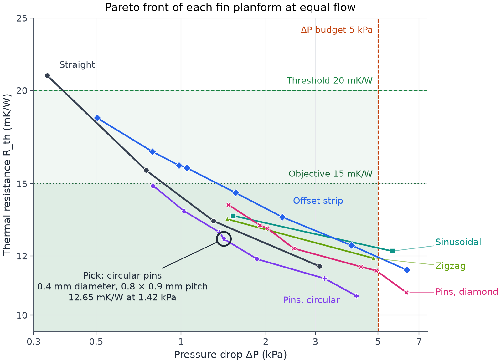
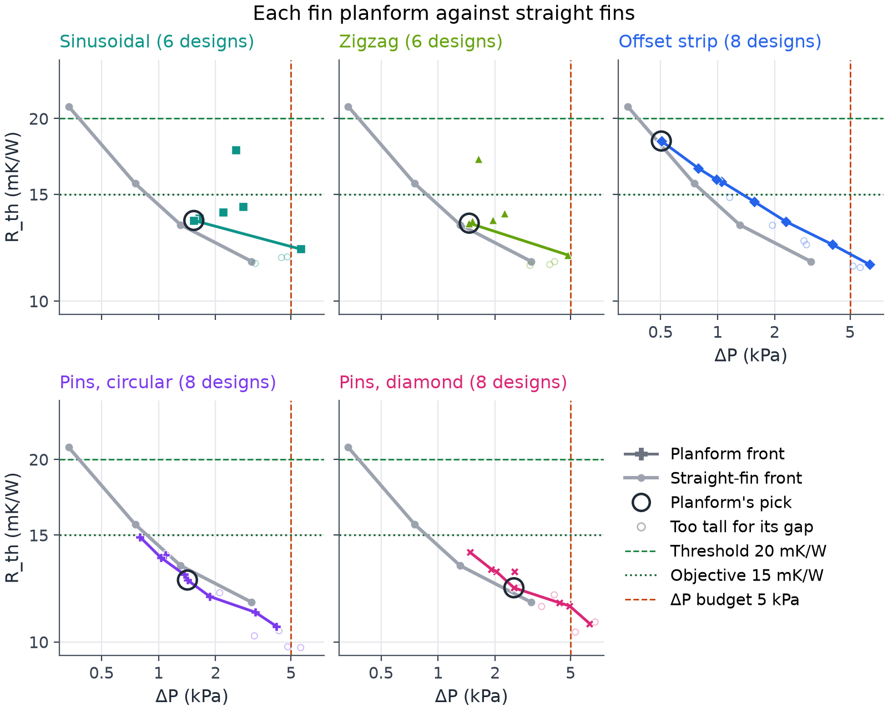
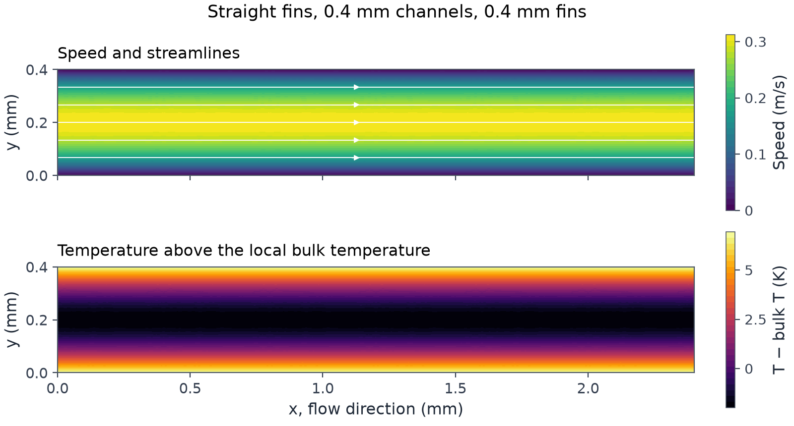
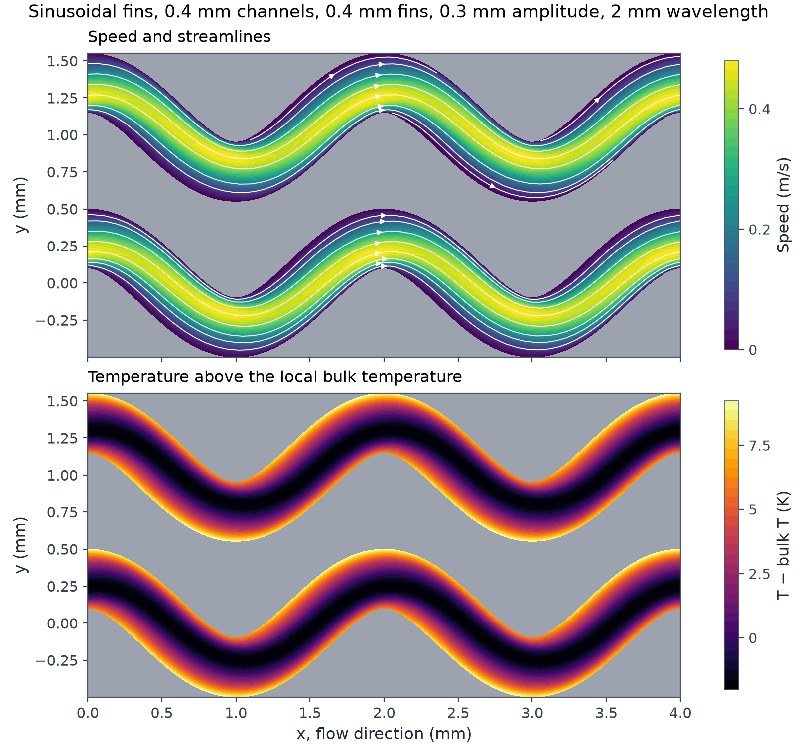
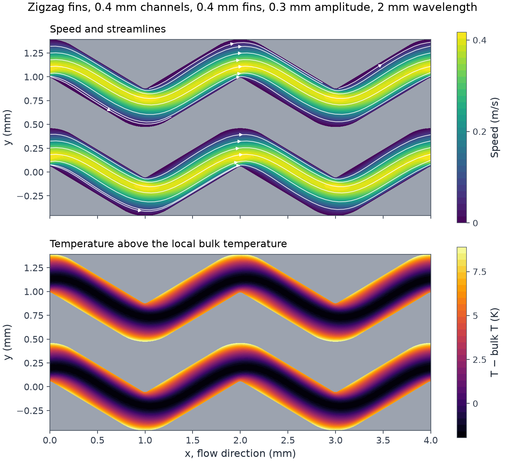
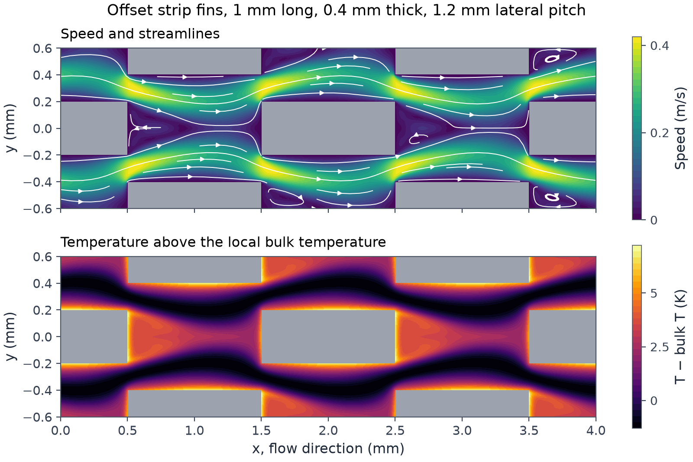
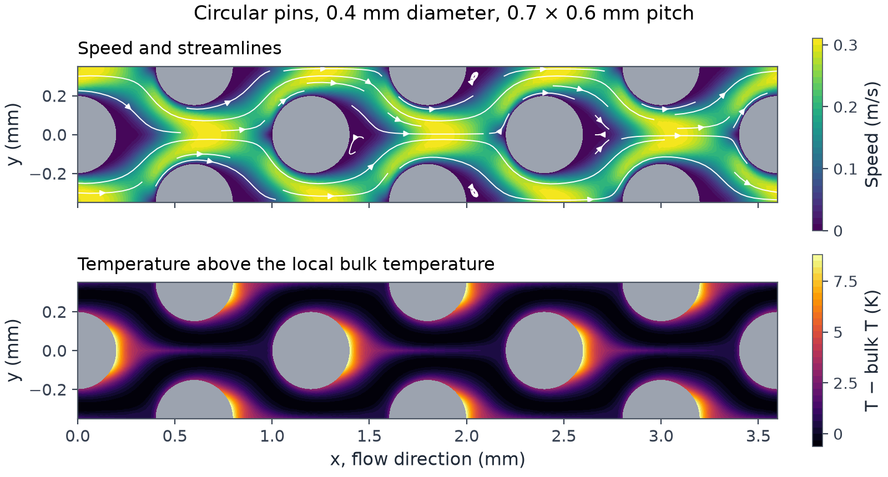
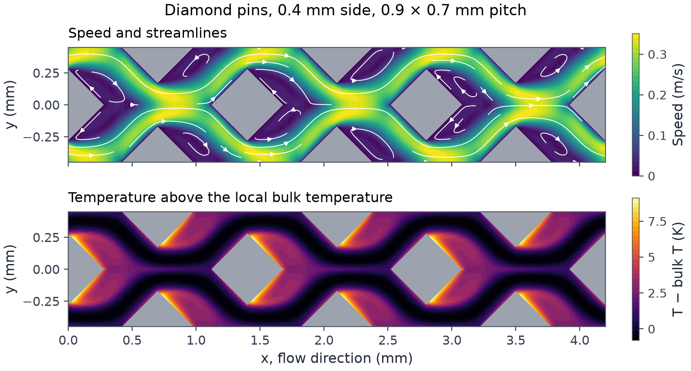

# Plan-view topology comparison: selection

Requirements (SPEC Amendment 3): ΔP ≤ 5 kPa, threshold R_th ≤ 20 mK/W (must meet), objective ≤ 15 mK/W (want), marginal-return cut-off 0.25, H / min gap ≤ 10. All numbers are plan-view (tall-fin limit), which reads R_th about 6% low on straight fins.

Rule: from the lowest-ΔP point of the eligible front (within budget and threshold), move to the nearest further point whose return e = −ln(R_j/R_i) / ln(ΔP_j/ΔP_i) is at least the cut-off; stop when none is. Capacity = threshold × heat load / R_th; kW per pumping W = heat load / (ΔP × flow). Both ratios always favour the lowest ΔP inside the window, which is why they are reported and not used to choose.

Each line is one planform's Pareto front over its eligible designs, at 1.5 LPM PG25 at 40 °C, 1 kW over 60 × 60 mm, copper, 2 mm base, features and gaps ≥ 0.15 mm, H / t ≤ 10 and H / gap ≤ 10. The ring marks the design the rule picks across all planforms. Not drawn: designs off the fronts, and the 36 designs excluded because their fins are taller than 10 × the narrowest gap. Shading: within the budget and the threshold (light), within the budget and the objective (darker). The model is 2D Navier-Stokes in the plane of the fin layer (tall-fin limit, developed periodic flow) plus a resistance network. It has no floor or cover: on straight fins it reads ΔP 7% and R_th 6% below the Level 1 cross-section CFD, so a gap between planforms smaller than that is not resolved.

One panel per planform: its eligible designs (markers) and Pareto front in colour, the straight-fin front in grey, and the planform's own pick (ring). Faint hollow markers are designs of that planform excluded by H / gap > 10. Same axes, budget, threshold and objective in every panel.

## Per topology

| Topology | Eligible / converged | Excluded (H/gap > 10) | Pick | R_th (mK/W) | ΔP (kPa) | Objective met | Capacity (kW) | kW per kPa | kW per pumping W |
|---|---|---|---|---|---|---|---|---|---|
| Straight | 6 / 12 | 6 | `straight_w0400_t0400_h_fin4000` (`marginal_return`) | 13.36 | 1.31 | yes | 1.50 | 1.15 | 30.6 |
| Sinusoidal | 6 / 10 | 4 | `sinusoidal_w0400_t0400_amp0300_lam4000_h_fin4000` (`marginal_return`) | 13.58 | 1.54 | yes | 1.47 | 0.96 | 26.1 |
| Zigzag | 6 / 10 | 4 | `zigzag_w0400_t0400_amp0300_lam4000_h_fin4000` (`marginal_return`) | 13.44 | 1.46 | yes | 1.49 | 1.02 | 27.4 |
| Offset strip | 8 / 15 | 7 | `offset_strip_l2000_t0400_p_t1600_g0000_h_fin4000` (`marginal_return`) | 18.36 | 0.50 | no | 1.09 | 2.16 | 79.2 |
| Pins, circular | 8 / 15 | 7 | `pin_circle_d0400_s_t0800_s_l0900_h_fin4000` (`marginal_return`) | 12.65 | 1.42 | yes | 1.58 | 1.11 | 28.2 |
| Pins, diamond | 8 / 16 | 8 | `pin_diamond_s0400_s_t1000_s_l0700_h_fin4000` (`marginal_return`) | 12.28 | 2.51 | yes | 1.63 | 0.65 | 15.9 |

### Straight

1. From straight_w0500_t0400_h_fin4000 (15.63 mK/W at 0.75 kPa): returns **0.283** to `straight_w0400_t0400_h_fin4000`; 0.209 to `straight_w0300_t0300_h_fin3000` → move to `straight_w0400_t0400_h_fin4000`.
2. From straight_w0400_t0400_h_fin4000 (13.36 mK/W at 1.31 kPa): returns 0.161 to `straight_w0300_t0300_h_fin3000` → stop.

### Sinusoidal

1. From sinusoidal_w0400_t0400_amp0300_lam4000_h_fin4000 (13.58 mK/W at 1.54 kPa): returns none → stop.

### Zigzag

1. From zigzag_w0400_t0400_amp0300_lam4000_h_fin4000 (13.44 mK/W at 1.46 kPa): returns 0.101 to `zigzag_w0300_t0300_amp0300_lam2000_h_fin3000` → stop.

### Offset strip

1. From offset_strip_l2000_t0400_p_t1600_g0000_h_fin4000 (18.36 mK/W at 0.50 kPa): returns 0.230 to `offset_strip_l1000_t0400_p_t1600_g0000_h_fin4000`; 0.219 to `offset_strip_l2000_t0300_p_t1200_g0000_h_fin3000`; 0.210 to `offset_strip_l0500_t0400_p_t1600_g0000_h_fin4000`; 0.204 to `offset_strip_l1000_t0300_p_t1200_g0000_h_fin3000`; 0.202 to `offset_strip_l0500_t0300_p_t1200_g0000_h_fin3000`; 0.189 to `offset_strip_l1000_t0200_p_t0800_g0000_h_fin2000` → stop.

### Pins, circular

1. From pin_circle_d0400_s_t1000_s_l0900_h_fin4000 (14.90 mK/W at 0.80 kPa): returns **0.309** to `pin_circle_d0400_s_t0900_s_l0900_h_fin4000`; **0.265** to `pin_circle_d0400_s_t0900_s_l0700_h_fin4000`; **0.284** to `pin_circle_d0400_s_t0800_s_l0900_h_fin4000`; **0.266** to `pin_circle_d0400_s_t0800_s_l0700_h_fin4000`; 0.204 to `pin_circle_d0300_s_t0600_s_l0700_h_fin3000`; 0.205 to `pin_circle_d0300_s_t0600_s_l0550_h_fin3000` → move to `pin_circle_d0400_s_t0900_s_l0900_h_fin4000`.
2. From pin_circle_d0400_s_t0900_s_l0900_h_fin4000 (13.78 mK/W at 1.03 kPa): returns 0.226 to `pin_circle_d0400_s_t0900_s_l0700_h_fin4000`; **0.264** to `pin_circle_d0400_s_t0800_s_l0900_h_fin4000`; 0.248 to `pin_circle_d0400_s_t0800_s_l0700_h_fin4000`; 0.181 to `pin_circle_d0300_s_t0600_s_l0700_h_fin3000`; 0.186 to `pin_circle_d0300_s_t0600_s_l0550_h_fin3000` → move to `pin_circle_d0400_s_t0800_s_l0900_h_fin4000`.
3. From pin_circle_d0400_s_t0800_s_l0900_h_fin4000 (12.65 mK/W at 1.42 kPa): returns 0.230 to `pin_circle_d0400_s_t0800_s_l0700_h_fin4000`; 0.148 to `pin_circle_d0300_s_t0600_s_l0700_h_fin3000`; 0.162 to `pin_circle_d0300_s_t0600_s_l0550_h_fin3000` → stop.

### Pins, diamond

1. From pin_diamond_s0400_s_t1100_s_l0900_h_fin4000 (14.05 mK/W at 1.48 kPa): returns 0.247 to `pin_diamond_s0400_s_t1000_s_l0900_h_fin4000`; 0.228 to `pin_diamond_s0400_s_t1100_s_l0700_h_fin4000`; **0.253** to `pin_diamond_s0400_s_t1000_s_l0700_h_fin4000`; 0.176 to `pin_diamond_s0300_s_t0750_s_l0700_h_fin3000`; 0.168 to `pin_diamond_s0300_s_t0850_s_l0500_h_fin3000` → move to `pin_diamond_s0400_s_t1000_s_l0700_h_fin4000`.
2. From pin_diamond_s0400_s_t1000_s_l0700_h_fin4000 (12.28 mK/W at 2.51 kPa): returns 0.103 to `pin_diamond_s0300_s_t0750_s_l0700_h_fin3000`; 0.102 to `pin_diamond_s0300_s_t0850_s_l0500_h_fin3000` → stop.

## Across all topologies

Pick: `pin_circle_d0400_s_t0800_s_l0900_h_fin4000` (Pins, circular), 12.65 mK/W at 1.42 kPa, rule `marginal_return`; meets the objective: yes.

1. From offset_strip_l2000_t0400_p_t1600_g0000_h_fin4000 (18.36 mK/W at 0.50 kPa): returns **0.404** to `straight_w0500_t0400_h_fin4000`; **0.457** to `pin_circle_d0400_s_t1000_s_l0900_h_fin4000`; **0.404** to `pin_circle_d0400_s_t0900_s_l0900_h_fin4000`; **0.334** to `straight_w0400_t0400_h_fin4000`; **0.353** to `pin_circle_d0400_s_t0900_s_l0700_h_fin4000`; **0.360** to `pin_circle_d0400_s_t0800_s_l0900_h_fin4000`; **0.333** to `pin_circle_d0400_s_t0800_s_l0700_h_fin4000`; **0.252** to `straight_w0300_t0300_h_fin3000`; **0.266** to `pin_circle_d0300_s_t0600_s_l0700_h_fin3000`; **0.259** to `pin_circle_d0300_s_t0600_s_l0550_h_fin3000` → move to `straight_w0500_t0400_h_fin4000`.
2. From straight_w0500_t0400_h_fin4000 (15.63 mK/W at 0.75 kPa): returns **0.822** to `pin_circle_d0400_s_t1000_s_l0900_h_fin4000`; **0.404** to `pin_circle_d0400_s_t0900_s_l0900_h_fin4000`; **0.283** to `straight_w0400_t0400_h_fin4000`; **0.318** to `pin_circle_d0400_s_t0900_s_l0700_h_fin4000`; **0.333** to `pin_circle_d0400_s_t0800_s_l0900_h_fin4000`; **0.302** to `pin_circle_d0400_s_t0800_s_l0700_h_fin4000`; 0.209 to `straight_w0300_t0300_h_fin3000`; 0.229 to `pin_circle_d0300_s_t0600_s_l0700_h_fin3000`; 0.225 to `pin_circle_d0300_s_t0600_s_l0550_h_fin3000` → move to `pin_circle_d0400_s_t1000_s_l0900_h_fin4000`.
3. From pin_circle_d0400_s_t1000_s_l0900_h_fin4000 (14.90 mK/W at 0.80 kPa): returns **0.309** to `pin_circle_d0400_s_t0900_s_l0900_h_fin4000`; 0.220 to `straight_w0400_t0400_h_fin4000`; **0.265** to `pin_circle_d0400_s_t0900_s_l0700_h_fin4000`; **0.284** to `pin_circle_d0400_s_t0800_s_l0900_h_fin4000`; **0.266** to `pin_circle_d0400_s_t0800_s_l0700_h_fin4000`; 0.183 to `straight_w0300_t0300_h_fin3000`; 0.204 to `pin_circle_d0300_s_t0600_s_l0700_h_fin3000`; 0.205 to `pin_circle_d0300_s_t0600_s_l0550_h_fin3000` → move to `pin_circle_d0400_s_t0900_s_l0900_h_fin4000`.
4. From pin_circle_d0400_s_t0900_s_l0900_h_fin4000 (13.78 mK/W at 1.03 kPa): returns 0.127 to `straight_w0400_t0400_h_fin4000`; 0.226 to `pin_circle_d0400_s_t0900_s_l0700_h_fin4000`; **0.264** to `pin_circle_d0400_s_t0800_s_l0900_h_fin4000`; 0.248 to `pin_circle_d0400_s_t0800_s_l0700_h_fin4000`; 0.154 to `straight_w0300_t0300_h_fin3000`; 0.181 to `pin_circle_d0300_s_t0600_s_l0700_h_fin3000`; 0.186 to `pin_circle_d0300_s_t0600_s_l0550_h_fin3000` → move to `pin_circle_d0400_s_t0800_s_l0900_h_fin4000`.
5. From pin_circle_d0400_s_t0800_s_l0900_h_fin4000 (12.65 mK/W at 1.42 kPa): returns 0.230 to `pin_circle_d0400_s_t0800_s_l0700_h_fin4000`; 0.108 to `straight_w0300_t0300_h_fin3000`; 0.148 to `pin_circle_d0300_s_t0600_s_l0700_h_fin3000`; 0.162 to `pin_circle_d0300_s_t0600_s_l0550_h_fin3000` → stop.

## Against the straight-fin front at equal ΔP (eligible designs)

| Design | ΔP (kPa) | R_th (mK/W) | Straight at same ΔP | Difference |
|---|---|---|---|---|
| `sinusoidal_w0400_t0400_amp0300_lam4000_h_fin4000` | 1.54 | 13.58 | 13.02 | +4.3% |
| `zigzag_w0400_t0400_amp0300_lam4000_h_fin4000` | 1.46 | 13.44 | 13.13 | +2.4% |
| `offset_strip_l2000_t0400_p_t1600_g0000_h_fin4000` | 0.50 | 18.36 | 18.06 | +1.7% |
| `offset_strip_l1000_t0400_p_t1600_g0000_h_fin4000` | 0.79 | 16.55 | 15.40 | +7.5% |
| `offset_strip_l2000_t0300_p_t1200_g0000_h_fin3000` | 0.99 | 15.86 | 14.47 | +9.6% |
| `offset_strip_l0500_t0400_p_t1600_g0000_h_fin4000` | 1.05 | 15.74 | 14.21 | +10.7% |
| `offset_strip_l1000_t0300_p_t1200_g0000_h_fin3000` | 1.57 | 14.58 | 12.98 | +12.3% |
| `offset_strip_l0500_t0300_p_t1200_g0000_h_fin3000` | 2.29 | 13.53 | 12.21 | +10.8% |
| `pin_circle_d0400_s_t1000_s_l0900_h_fin4000` | 0.80 | 14.90 | 15.37 | -3.1% |
| `pin_circle_d0400_s_t0900_s_l0900_h_fin4000` | 1.03 | 13.78 | 14.30 | -3.7% |
| `pin_circle_d0400_s_t0900_s_l0700_h_fin4000` | 1.37 | 12.91 | 13.26 | -2.6% |
| `pin_circle_d0400_s_t0800_s_l0900_h_fin4000` | 1.42 | 12.65 | 13.19 | -4.1% |
| `pin_circle_d0400_s_t0800_s_l0700_h_fin4000` | 1.86 | 11.88 | 12.62 | -5.8% |
| `pin_diamond_s0400_s_t1100_s_l0900_h_fin4000` | 1.48 | 14.05 | 13.10 | +7.2% |
| `pin_diamond_s0400_s_t1000_s_l0900_h_fin4000` | 1.91 | 13.19 | 12.57 | +4.9% |
| `pin_diamond_s0400_s_t1100_s_l0700_h_fin4000` | 2.03 | 13.07 | 12.45 | +5.0% |
| `pin_diamond_s0400_s_t1000_s_l0700_h_fin4000` | 2.51 | 12.28 | 12.03 | +2.1% |

## Excluded by H / min gap > 10 (solved, kept in results.json, not in fronts or selection)

| Design | Reason |
|---|---|
| `straight_w0150_t0400_h_fin4000` | H / min gap = 4 / 0.150 = 26.7 > 10 |
| `straight_w0200_t0400_h_fin4000` | H / min gap = 4 / 0.200 = 20.0 > 10 |
| `straight_w0250_t0400_h_fin4000` | H / min gap = 4 / 0.250 = 16.0 > 10 |
| `straight_w0300_t0400_h_fin4000` | H / min gap = 4 / 0.300 = 13.3 > 10 |
| `straight_w0150_t0300_h_fin3000` | H / min gap = 3 / 0.150 = 20.0 > 10 |
| `straight_w0200_t0300_h_fin3000` | H / min gap = 3 / 0.200 = 15.0 > 10 |
| `sinusoidal_w0300_t0400_amp0150_lam2000_h_fin4000` | H / min gap = 4 / 0.300 = 13.3 > 10 |
| `sinusoidal_w0300_t0400_amp0300_lam2000_h_fin4000` | H / min gap = 4 / 0.300 = 13.3 > 10 |
| `sinusoidal_w0300_t0400_amp0600_lam4000_h_fin4000` | H / min gap = 4 / 0.300 = 13.3 > 10 |
| `sinusoidal_w0200_t0400_amp0300_lam2000_h_fin4000` | H / min gap = 4 / 0.200 = 20.0 > 10 |
| `zigzag_w0300_t0400_amp0150_lam2000_h_fin4000` | H / min gap = 4 / 0.300 = 13.3 > 10 |
| `zigzag_w0300_t0400_amp0300_lam2000_h_fin4000` | H / min gap = 4 / 0.300 = 13.3 > 10 |
| `zigzag_w0300_t0400_amp0600_lam4000_h_fin4000` | H / min gap = 4 / 0.300 = 13.3 > 10 |
| `zigzag_w0200_t0400_amp0300_lam2000_h_fin4000` | H / min gap = 4 / 0.200 = 20.0 > 10 |
| `offset_strip_l0500_t0400_p_t1100_g0000_h_fin4000` | H / min gap = 4 / 0.150 = 26.7 > 10 |
| `offset_strip_l1000_t0400_p_t1100_g0000_h_fin4000` | H / min gap = 4 / 0.150 = 26.7 > 10 |
| `offset_strip_l2000_t0400_p_t1100_g0000_h_fin4000` | H / min gap = 4 / 0.150 = 26.7 > 10 |
| `offset_strip_l0500_t0400_p_t1300_g0000_h_fin4000` | H / min gap = 4 / 0.250 = 16.0 > 10 |
| `offset_strip_l1000_t0400_p_t1300_g0000_h_fin4000` | H / min gap = 4 / 0.250 = 16.0 > 10 |
| `offset_strip_l2000_t0400_p_t1300_g0000_h_fin4000` | H / min gap = 4 / 0.250 = 16.0 > 10 |
| `offset_strip_l1000_t0300_p_t0900_g0000_h_fin3000` | H / min gap = 3 / 0.150 = 20.0 > 10 |
| `pin_circle_d0400_s_t0600_s_l0500_h_fin4000` | H / min gap = 4 / 0.183 = 21.8 > 10 |
| `pin_circle_d0400_s_t0600_s_l0700_h_fin4000` | H / min gap = 4 / 0.200 = 20.0 > 10 |
| `pin_circle_d0400_s_t0600_s_l0900_h_fin4000` | H / min gap = 4 / 0.200 = 20.0 > 10 |
| `pin_circle_d0400_s_t0800_s_l0500_h_fin4000` | H / min gap = 4 / 0.240 = 16.6 > 10 |
| `pin_circle_d0400_s_t1000_s_l0500_h_fin4000` | H / min gap = 4 / 0.307 = 13.0 > 10 |
| `pin_circle_d0600_s_t0900_s_l0700_h_fin4000` | H / min gap = 4 / 0.232 = 17.2 > 10 |
| `pin_circle_d0300_s_t0500_s_l0450_h_fin3000` | H / min gap = 3 / 0.200 = 15.0 > 10 |
| `pin_diamond_s0400_s_t0750_s_l0500_h_fin4000` | H / min gap = 4 / 0.184 = 21.7 > 10 |
| `pin_diamond_s0400_s_t0750_s_l0700_h_fin4000` | H / min gap = 4 / 0.184 = 21.7 > 10 |
| `pin_diamond_s0400_s_t0750_s_l0900_h_fin4000` | H / min gap = 4 / 0.184 = 21.7 > 10 |
| `pin_diamond_s0400_s_t0900_s_l0500_h_fin4000` | H / min gap = 4 / 0.272 = 14.7 > 10 |
| `pin_diamond_s0400_s_t0900_s_l0700_h_fin4000` | H / min gap = 4 / 0.334 = 12.0 > 10 |
| `pin_diamond_s0400_s_t0900_s_l0900_h_fin4000` | H / min gap = 4 / 0.334 = 12.0 > 10 |
| `pin_diamond_s0400_s_t1100_s_l0500_h_fin4000` | H / min gap = 4 / 0.342 = 11.7 > 10 |
| `pin_diamond_s0300_s_t0600_s_l0450_h_fin3000` | H / min gap = 3 / 0.176 = 17.1 > 10 |

## Field plots

One design per planform, solved as a developed periodic cell and tiled over a few periods; fins are grey. Top: speed with streamlines. Bottom: temperature above the local mean bulk temperature (velocity-weighted) under a uniform wall heat flux, the periodic part only. All at 1.5 LPM PG25. Pin pitch is transverse × streamwise.

Straight fins, 0.4 mm channels, 0.4 mm fins, 4 mm tall: Re_Dh = 121 (Dh = 0.800 mm), dp/dx = 21.8 kPa/m, h = 4.9 kW/m²K, wall flux 3.4 W/cm² → ΔP 1.31 kPa, R_th 13.4 mK/W.

Sinusoidal fins, 0.4 mm channels, 0.4 mm fins, 0.3 mm amplitude, 2 mm wavelength, 4 mm tall: Re_Dh = 133 (Dh = 0.800 mm), dp/dx = 46.4 kPa/m, h = 4.5 kW/m²K, wall flux 3.6 W/cm² → ΔP 2.79 kPa, R_th 14.3 mK/W.

Zigzag fins, 0.4 mm channels, 0.4 mm fins, 0.3 mm amplitude, 2 mm wavelength, 4 mm tall: Re_Dh = 124 (Dh = 0.800 mm), dp/dx = 37.3 kPa/m, h = 4.6 kW/m²K, wall flux 3.4 W/cm² → ΔP 2.24 kPa, R_th 13.9 mK/W.

Offset strip fins, 1 mm long, 0.4 mm thick, 1.2 mm lateral pitch, 4 mm tall: Re_Dh = 129 (Dh = 1.143 mm), dp/dx = 49.9 kPa/m, h = 7.2 kW/m²K, wall flux 4.3 W/cm² → ΔP 2.99 kPa, R_th 12.4 mK/W.

Circular pins, 0.4 mm diameter, 0.7 × 0.6 mm pitch, 4 mm tall: Re_Dh = 101 (Dh = 0.937 mm), dp/dx = 57.1 kPa/m, h = 11.3 kW/m²K, wall flux 4.5 W/cm² → ΔP 3.42 kPa, R_th 10.4 mK/W.

Diamond pins, 0.4 mm side, 0.9 × 0.7 mm pitch, 4 mm tall: Re_Dh = 119 (Dh = 1.175 mm), dp/dx = 58.6 kPa/m, h = 9.9 kW/m²K, wall flux 4.9 W/cm² → ΔP 3.52 kPa, R_th 11.4 mK/W.
