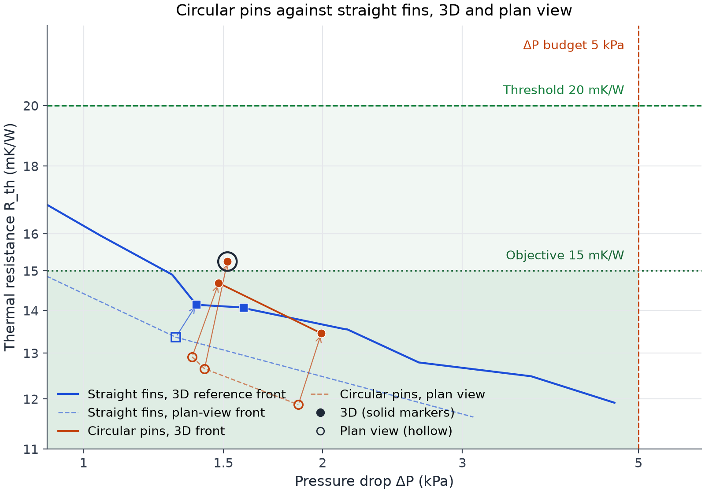
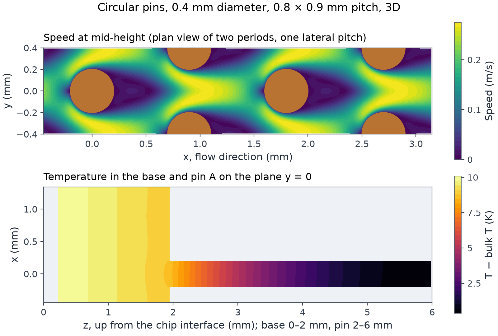

# Level 3 stage two: circular pins against straight fins in 3D

OpenFOAM v2406 `chtMultiRegionSimpleFoam` in Docker (`opencfd/openfoam-default:2406@sha256:dd5aa20630a55722663bf83ba0cb74870cba130081303e32e3865007fa2aa35a`), steady laminar, constant properties (PG25 at 40 °C, copper k = 390 W/m·K). Staggered circular pins as in the plan view (`level2/planforms.py`): one stagger period streamwise (periodic, mean velocity held), half a transverse pitch with symmetry planes, full pin height with a no-slip floor and an adiabatic no-slip cover on the pin tips, the 2 mm copper base under 1 kW uniform over the 60 × 60 mm footprint, conjugate conduction in pins and base. Flow 1.5 LPM over the 60 mm width (superficial velocity Q / (W H), as the plan view). R_th = (base-underside area average − period-mean bulk) / Q plus half the coolant rise, ΔP = dp/dx × 60 mm, both as stage one. Mesh: gmsh quadrilaterals in plan extruded to hexahedra, two conformal regions (`level3/pins.py`).

## P0: plan-view cross-check (fluid only, slip floor and cover)

The pick `pin_circle_d0400_s_t0800_s_l0900_h_fin4000` as a 0.05 mm slab one cell thick, symmetry (slip) floor and cover, no base, uniform flux on the pin walls: the problem the plan-view solver solves. h = wall flux / (period-mean wall T − period-mean velocity-weighted bulk T), the plan-view definition.

| Mesh | Cells | dp/dx (Pa/m) | h (W/m²K) | Final residual | Energy balance |
|---|---|---|---|---|---|
| factor 2 (production) | 4,153 | 23721 | 11263 | 7.8e-11 | +5.9e-11% |
| factor 4 (2× finer in plan) | 16,593 | 23736 | 11205 | 1.9e-10 | -3.8e-11% |
| plan view (Taylor-Hood, 10 cells per gap) | — | 23675 | 11159 | — | — |

| Gate | Value | Limit | Result |
|---|---|---|---|
| dpdx vs plan view | +0.20% | ±3% | pass |
| h vs plan view | +0.92% | ±3% | pass |
| dpdx production vs fine | -0.06% | ±2% | pass |
| h production vs fine | +0.52% | ±2% | pass |

## Serial against parallel (coarse conjugate pick)

Factor 1 mesh (42,784 cells), 3000 iterations: serial R_th 15.2288 mK/W, ΔP 1512.57 Pa; four processes (scotch) 15.2288 mK/W, 1512.57 Pa (difference +3.9e-09% and +0.0e+00%, limit 0.1%: pass). Run times 749 s and 205 s.
The same coarse mesh (half the production resolution in every direction) differs from the production run by -0.11% on R_th and -0.36% on ΔP; the gate is production against 2× finer (detached job below).

## Pins in 3D against the plan view

| Design | Re_d,max | Plan view R_th (mK/W) | 3D R_th (mK/W) | 3D / plan | Plan view ΔP (kPa) | 3D ΔP (kPa) | 3D / plan | Cells | Residual | Flat (last 10%) | Energy balance | Run time (min) | Peak memory (GB) |
|---|---|---|---|---|---|---|---|---|---|---|---|---|---|
| `pin_circle_d0400_s_t0900_s_l0700_h_fin4000` | 54.4 | 12.91 | 14.68 | 1.137 | 1.370 | 1.480 | 1.080 | 280,448 | 6.0e-10 (pass) | 1.2e-05% (pass) | -5.4e-08% (pass) | 65 | 0.9 |
| `pin_circle_d0400_s_t0800_s_l0900_h_fin4000` (pick) | 60.4 | 12.65 | 15.24 | 1.205 | 1.420 | 1.518 | 1.069 | 328,944 | 7.0e-10 (pass) | 1.6e-05% (pass) | -7.9e-08% (pass) | 71 | 1.0 |
| `pin_circle_d0400_s_t0800_s_l0700_h_fin4000` | 60.4 | 11.88 | 13.45 | 1.132 | 1.865 | 1.993 | 1.069 | 296,688 | 1.7e-10 (pass) | 3.5e-06% (pass) | -1.7e-08% (pass) | 67 | 0.9 |

Heat path, `pin_circle_d0400_s_t0900_s_l0700_h_fin4000`: 4.9% of the heat enters the coolant through the floor between the pins in 3D, against 16.7% in the plan-view network, which gives the floor the pins' h (ASSUMPTIONS V4). From the wall heat flux on the interface (`chtMultiRegionSimpleFoam -postProcess -func wallHeatFlux`), split by face orientation.

Heat path, `pin_circle_d0400_s_t0800_s_l0900_h_fin4000`: 5.4% of the heat enters the coolant through the floor between the pins in 3D, against 20.6% in the plan-view network, which gives the floor the pins' h (ASSUMPTIONS V4). From the wall heat flux on the interface (`chtMultiRegionSimpleFoam -postProcess -func wallHeatFlux`), split by face orientation.

Heat path, `pin_circle_d0400_s_t0800_s_l0700_h_fin4000`: 3.7% of the heat enters the coolant through the floor between the pins in 3D, against 15.4% in the plan-view network, which gives the floor the pins' h (ASSUMPTIONS V4). From the wall heat flux on the interface (`chtMultiRegionSimpleFoam -postProcess -func wallHeatFlux`), split by face orientation.

Gates per run: largest final initial residual (all velocity components, pressure and both energy equations, normalised) < 1e-08; R_th and ΔP flat to 0.1% over the last 10% of iterations; heat crossing the fluid-solid interface within 1% of the applied heat. For straight fins the plan view reads R_th 5.6% and ΔP 7.1% below Level 1 (no floor or cover); the 3D / plan ratios above are the same bias for pins.

## Straight fins in 3D (stage-one model)

| Design | Role | 3D R_th (mK/W) | 3D ΔP (kPa) | Reference | 3D / reference R_th | 3D / reference ΔP |
|---|---|---|---|---|---|---|
| `w0387_t0387_h3750_q150` | Level 1 pick | 14.072 | 1.591 | Level 1 CFD 14.05 mK/W, 1.600 kPa | 1.002 | 0.995 |
| `w0400_t0400_h4000_q150` | plan-view straight pick | 14.139 | 1.387 | plan view 13.36 mK/W, 1.307 kPa | 1.058 | 1.061 |

The 3D straight-fin reference used below is the Pareto front of the committed Level 1 CFD designs (`examples/output/gpu_coldplate/results.json`) together with the two 3D straight points, interpolated in log-log as the plan-view comparison does; between the 3D points it is the Level 1 CFD front, which stage one showed the 3D model reproduces within 0.3%. Its 2× refinement changes R_th by +0.12% and ΔP by -0.41%. At its own ΔP the Level 1 CFD front reads 14.614 mK/W, so this 3D point sits -3.25% from that front: 0.40 / 0.40 / 4.0 mm is not on the Level 1 grid, and between its grid points (0.42 / 0.39 / 3.75 and 0.39 / 0.39 / 3.75 mm) the Level 1 front is a chord that a better straight design lies below.

## Pins against straight fins at equal ΔP

| Design | 3D ΔP (kPa) | 3D R_th (mK/W) | Straight, 3D reference at that ΔP (mK/W) | 3D difference | Against the Level 1 front alone | Plan-view difference |
|---|---|---|---|---|---|---|
| `pin_circle_d0400_s_t0900_s_l0700_h_fin4000` | 1.480 | 14.68 | 14.11 | +4.1% | +2.3% | -2.6% |
| `pin_circle_d0400_s_t0800_s_l0900_h_fin4000` | 1.518 | 15.24 | 14.10 | +8.2% | +6.9% | -4.1% |
| `pin_circle_d0400_s_t0800_s_l0700_h_fin4000` | 1.993 | 13.45 | 13.67 | -1.6% | -1.6% | -5.8% |

| Equal ΔP (kPa) | Pins, 3D (mK/W) | Straight, 3D reference (mK/W) | Difference |
|---|---|---|---|
| 1.48 | 14.68 | 14.11 | +4.1% |
| 1.74 | 14.01 | 13.91 | +0.7% |
| 1.99 | 13.45 | 13.67 | -1.6% |

Pins between the 3D designs are interpolated in log-log along their 3D Pareto front (designs it dominates are left out).

**Answer.** The plan view puts these three pin designs -5.8% to -2.6% against straight fins at equal ΔP. In 3D they are -1.6% to +8.2%: the pin lead does not survive as a lead. In 3D the pins' R_th rises by 13–21% over the plan view (ΔP by 7–8%), against about 6% (R_th) and 6–7% (ΔP) for straight fins. Most of the extra R_th is at the floor: the plan-view network gives the floor between the pins the pins' h and so sends 15–21% of the heat through it, while in 3D the floor carries 3.7–5.4%; splitting the convective conductance by heat share, about two thirds of what is lost is at the floor and one third at the pins, whose roots, where most of their heat leaves, sit in the slow flow near the floor. The cross-topology pick is dominated in 3D by its lower-ΔP neighbour. Near 1.5 kPa, where the straight reference is anchored by two 3D points, pins are worse by about 4% or more; near 2 kPa the best pin design is -1.6% against a straight reference that is, there, a chord between two Level 1 grid designs (the plan-view straight pick lies 3.3% below such a chord), so that difference is not resolved: a tie within the uncertainty of the straight reference.

R_th against channel-core ΔP at 1.5 LPM PG25 at 40 °C, 1 kW over 60 × 60 mm, copper, 2 mm base. Solid markers: 3D conjugate (OpenFOAM); hollow markers: plan view (2D, tall-fin limit, no floor or cover); arrows go from each design's plan-view value to its 3D value. Orange circles: circular pins (ring: the cross-topology pick); blue squares: straight fins (Level 1 pick, from stage one, and the plan-view straight pick). Blue solid line: the 3D straight-fin reference (Level 1 CFD designs and the two 3D straight points, Pareto front); dashed lines: plan-view fronts. Vertical line: 5 kPa budget; horizontal lines: 20 mK/W threshold and 15 mK/W objective.

The pick in 3D. Top: speed on the mid-height plane (z = t_b + H / 2), the computed half pitch mirrored about its symmetry planes and repeated over two stagger periods; pins in copper colour. Bottom: temperature above the period-mean bulk temperature on the symmetry plane through pin A (y = 0), in the base and the pin (the fluid on that plane is left blank).

## Long jobs (detached)

Not started.

