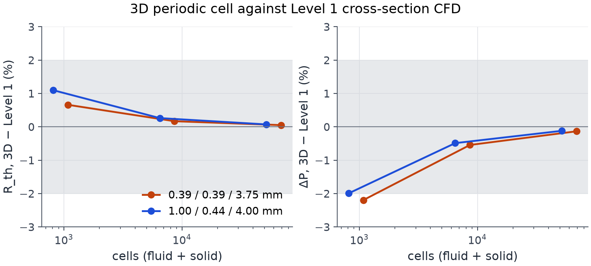

# Level 3 stage one: 3D straight-fin validation

OpenFOAM v2406 `chtMultiRegionSimpleFoam` in Docker (`opencfd/openfoam-default:2406@sha256:dd5aa20630a55722663bf83ba0cb74870cba130081303e32e3865007fa2aa35a`), steady laminar, constant properties. One half fin and one half channel with symmetry planes on both sides, 2 mm copper base under uniform flux, adiabatic cover, no tip clearance. Streamwise-periodic (fully developed): mean velocity held at the Level 1 value, temperature solved as a linear rise plus a periodic part. R_th = (base-underside area average − local bulk) / Q plus half the coolant rise, ΔP = dp/dx × 60 mm, as Level 1. Reference values are read from `examples/output/gpu_coldplate/results.json`.

## `w0387_t0387_h3750_q150` (Level 1 recommended)

0.387 mm channel, 0.387 mm fin, 3.75 mm tall, 77 channels, Re 114. Level 1: 14.049 mK/W, 1599.9 Pa.

| Level | Cells (fluid + solid) | R_th (mK/W) | vs Level 1 | ΔP (Pa) | vs Level 1 | f·Re (exact duct) | Energy balance | Iterations | Final residual | Run time (s) | Peak memory (MB) |
|---|---|---|---|---|---|---|---|---|---|---|---|
| 0 | 1,080 | 14.1412 | +0.66% | 1564.76 | -2.20% | 20.627 (21.090) | -6.2e-09% | 1000 | 1.1e-11 | 13 | 538 |
| 1 (production) | 8,640 | 14.0722 | +0.17% | 1591.17 | -0.54% | 20.975 (21.090) | -7.4e-09% | 1500 | 2.2e-11 | 38 | 545 |
| 2 (fine) | 69,120 | 14.0557 | +0.05% | 1597.73 | -0.14% | 21.061 (21.090) | -8.6e-09% | 3000 | 4.2e-11 | 559 | 605 |

Richardson extrapolation over the three levels (observed order 2.07 on R_th, 2.01 on ΔP): R_th 14.0506 mK/W (+0.01% from Level 1), ΔP 1599.89 Pa (-0.00%). Not used by any gate.

| Gate | Value | Limit | Result |
|---|---|---|---|
| G1 R_th vs Level 1 | +0.17% | ±2% | pass |
| G1 ΔP vs Level 1 | -0.54% | ±2% | pass |
| G2 R_th production vs fine | +0.12% | ±2% | pass |
| G2 ΔP production vs fine | -0.41% | ±2% | pass |
| G3 energy balance: heat into the coolant across the interface vs applied | 8.6e-09% | 1% | pass |
| G4 final initial residual (Ux, h fluid, h solid) | 4.2e-11 | < 1e-8 | pass |
| G4 R_th and ΔP flat over the last 10% of iterations | 4.4e-08% | 0.1% | pass |

## `w1000_t0444_h4000_q150` (widest channel, lowest H / w)

1.000 mm channel, 0.444 mm fin, 4.00 mm tall, 41 channels, Re 177. Level 1: 35.979 mK/W, 181.6 Pa.

| Level | Cells (fluid + solid) | R_th (mK/W) | vs Level 1 | ΔP (Pa) | vs Level 1 | f·Re (exact duct) | Energy balance | Iterations | Final residual | Run time (s) | Peak memory (MB) |
|---|---|---|---|---|---|---|---|---|---|---|---|
| 0 | 810 | 36.3738 | +1.10% | 177.99 | -1.99% | 17.869 (18.233) | -2.6e-08% | 1000 | 2.0e-11 | 12 | 537 |
| 1 (production) | 6,480 | 36.0730 | +0.26% | 180.72 | -0.49% | 18.144 (18.233) | -2.9e-08% | 1500 | 1.8e-11 | 32 | 544 |
| 2 (fine) | 51,840 | 36.0049 | +0.07% | 181.39 | -0.12% | 18.211 (18.233) | -8.9e-08% | 3000 | 8.2e-11 | 395 | 593 |

Richardson extrapolation over the three levels (observed order 2.14 on R_th, 2.03 on ΔP): R_th 35.9849 mK/W (+0.02% from Level 1), ΔP 181.61 Pa (-0.00%). Not used by any gate.

| Gate | Value | Limit | Result |
|---|---|---|---|
| G1 R_th vs Level 1 | +0.26% | ±2% | pass |
| G1 ΔP vs Level 1 | -0.49% | ±2% | pass |
| G2 R_th production vs fine | +0.19% | ±2% | pass |
| G2 ΔP production vs fine | -0.37% | ±2% | pass |
| G3 energy balance: heat into the coolant across the interface vs applied | 8.9e-08% | 1% | pass |
| G4 final initial residual (Ux, h fluid, h solid) | 8.2e-11 | < 1e-8 | pass |
| G4 R_th and ΔP flat over the last 10% of iterations | 1.7e-06% | 0.1% | pass |

R_th (left) and ΔP (right) of the 3D periodic cell relative to the Level 1 cross-section CFD at three mesh levels (each 2× finer in every direction); the band is ±2% (gate G1). Level 1 is the production mesh of the committed study; the fine level is the refinement check (gate G2).

Notes. The energy balance compares the heat that crosses the fluid-solid interface, computed from the fluid-side temperature gradient, with the heat applied at the base (the base flux itself is a boundary condition, so it is not a check); in the periodic formulation the coolant's enthalpy rise is the sink term, which removes exactly the applied heat, so G3 is a conservation check of the coupled solve rather than an independent caloric measurement. The f·Re column compares the 3D flow solve with the exact series solution for a rectangular duct (Shah & London 1978), independent of Level 1. ΔP is a pressure gradient held by `meanVelocityForce` times 60 mm; normalised residuals of the cross-stream velocity and pressure are round-off (|u_y|, |u_z| ≈ 1e-12 m/s) and are not used. Only straight fins are run here; pins are stage two.
